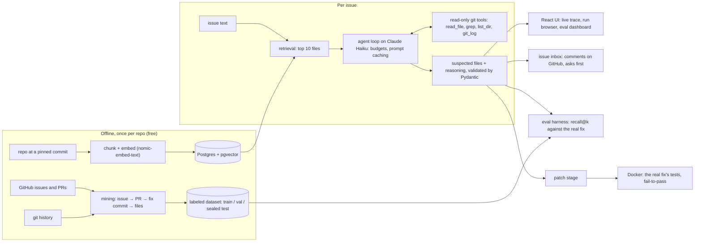

# Vite Triage Agent

An AI agent that reads a GitHub issue, searches and reads the codebase, and says
**which files the fix belongs in**, then is graded against the files the real
fix actually changed.

- **RAG over a real codebase:** chunking, local embeddings in Postgres/pgvector,
  file-level retrieval, with every change scored by recall@k.
- **A tool-using agent on Claude**, written by hand against the Messages API:
  four read-only git tools, typed and validated output, turn, token, time and
  dollar budgets, prompt caching, and a live trace streamed to a React UI.
- **An evaluation harness that is the product:** 1,375 issues mined from Vite's
  history as ground truth, a temporal train/val/test split, ablations with
  paired bootstrap intervals, and a test split sealed until the end.
- **Patch and verify:** the agent writes a patch against the commit before the
  fix, and Docker runs the real fix's own tests on it (fail-to-pass).
- **Real use:** an on-demand inbox that triages your own repo's open issues and
  asks before spending or posting a comment.

## The result

On **154 held-out test issues** that nothing was tuned on (Vite's test split,
opened once at the end, clean rows), with recall@1 meaning *the first file
proposed is one the real fix changed*:

| system | recall@1 | recall@5 | cost per triage |
|---|---|---|---|
| retrieval alone (embeddings, no model call) | 26.6% | 56.2% | $0 |
| grounded: the model re-ranks retrieval's top 10 | 48.4% | 65.1% | $0.0017 |
| **agent: the model also opens files with read-only git tools** | **54.6%** | **69.1%** | **$0.0021** |

- **Looking pays, on data it never saw.** The agent beats a single re-rank by
  +6.2 points of recall@1 (95% paired interval [+0.6, +11.9]). On val it was
  +8.0: the gap shrank but held.
- **Retrieval sets the ceiling, and a cheap change moved it.** Prefixing each
  chunk with its file path and imports lifted recall@10 from 64.1% to 68.5%. A
  tree-sitter chunker was a measured negative result, with a mechanical cause.
- **Finding the file is not fixing the bug.** Patches written against the
  pre-fix commit and run against the real fix's own tests pass 24% of the time
  (6 of 25), and at this sample size finding the right file did not visibly
  predict a pass.
- **Where it fails.** Of 20 hand-read misses, 6 never looked past retrieval's
  top 10 and 5 picked the file where the symptom shows instead of where the fix
  went ([failure taxonomy](docs/failure-taxonomy.md)).

One repeat on test, and the agent is nondeterministic per run; the caveats,
including a token-budget fix found after the test run (agent recall@1 about
0.1 point lower under it), are in [MEASUREMENTS.md](MEASUREMENTS.md).

## Architecture



| Piece | Code | What it does |
|---|---|---|
| Ground truth | `mining/` | Reconstructs issue → PR → commit → files from the GitHub API and git, pins a commit, splits by date |
| Retrieval | `retrieval/` | Chunks the repo at the pin, embeds locally with Ollama, ranks files by their best chunk |
| Agent | `agent/` | The tool-use loop, its budgets and caching; the staged pipeline; the patch stage |
| API | `api/` | FastAPI routes, the provider seam (Anthropic or Ollama), cost accounting, the live-run registry, one typed contract |
| Evaluation | `eval/` | Every score, ablation, report, the Docker verify harness, the nightly eval and the test-split seal |
| Inbox | `inbox/` | Triage a repo's open issues on demand and post the answers as comments |
| Web | `web/` | React + TypeScript: triage with a live trace, the run browser, the eval dashboard |

**Stack:** Python 3.12, FastAPI, Pydantic, Postgres + pgvector, Ollama
(embeddings), Claude Haiku 5.5 via the Anthropic SDK, Docker, React 19 +
TypeScript + Vite, pytest and Vitest (500+ tests, none of them paid). No agent
framework, by choice: every layer is something to measure
([why](ARCHITECTURE.md#deliberately-absent)).

How the pieces fit and why each boundary is where it is:
[ARCHITECTURE.md](ARCHITECTURE.md). Every number with its caveats:
[MEASUREMENTS.md](MEASUREMENTS.md).

## Run it

You need Python 3.12, Node, Docker, and [Ollama](https://ollama.com) (retrieval
embeds locally with `nomic-embed-text`, so it runs even when the model calls go
to Anthropic).

```bash
python3 -m venv .venv && source .venv/bin/activate
pip install -r requirements.txt
cp .env.example .env               # add a GitHub token; an Anthropic key for paid runs
git clone https://github.com/vitejs/vite.git repos/vite
ollama pull nomic-embed-text       # embeddings; also qwen2.5-coder:7b for free local triage
docker compose up -d               # Postgres + pgvector on port 5433

python -m mining all               # labeled dataset, pinned commit, splits (see below)
python -m retrieval.index --strategy fixed_v1_header
```

Run the app with one command (it checks Docker, Ollama, the ports and the
installs first, and prints the fix for anything missing; Ctrl-C stops both servers):

```bash
.venv/bin/python scripts/dev.py                 # API :8000, web http://localhost:5173
```

Or by hand:

```bash
docker compose up -d
PROVIDER=anthropic python -m uvicorn api.main:app --port 8000 --reload
cd web && npm ci && npm run dev                 # http://localhost:5173
```

Three views: **Triage** (below), **Runs** (`#/runs`, the stored staged runs stage by
stage with the agent's diff beside the real fix's) and **Eval** (`#/eval`, the
dashboard: nightly retrieval, the arms, staged and patch outcomes, the failure
taxonomy, all read from stored files).

The page has three buttons. **Prose (Phase 01)** and **Typed triage** see only
the issue. **Agent (live)** also gets retrieval's top 10 files and four read-only tools,
and runs in the background: you watch the trace fill in as it goes (each tool
call and its result), with meters for turns, tokens, dollars and seconds
against their limits, then the result. Reload the page and a run the server
still remembers reopens. It needs `PROVIDER=anthropic`; the other two buttons
also run on the free local model (`PROVIDER=ollama`).

A run stops when it reaches a budget, set in `.env`: `AGENT_MAX_TURNS` (12),
`AGENT_MAX_TOKENS` (150000), `AGENT_MAX_SECONDS` (180) and `AGENT_MAX_DOLLARS`
(0.05). They are checked before each model call after the first, so a run can
overshoot a limit by at most one call. `LIVE_MAX_CONCURRENT`, `LIVE_TTL_SECONDS`
and `LIVE_KEEPALIVE_SECONDS` size the live-run registry. Restarting the API
drops runs that are in progress.

Use `npm ci`, not `npm install`: the lockfile was created with
`--legacy-peer-deps` because npm 10.9.2 crashes on a plain install.

## Triage your own repo

`inbox/` runs the agent on a repository you own and posts its answers as
issue comments, only when you ask. Point a corpus file at the repo (see
[Another repo](#another-repo)), mine and index it once, then:

```bash
ENV_FILE=.env.<name> GITHUB_TOKEN=$(gh auth token) PROVIDER=anthropic python -m inbox
```

It never runs on a schedule, and every question defaults to **no** (Enter,
`n` or Ctrl-D):

1. **"Branch moved: re-pin and re-index?"** Free, about a minute. Declining
   keeps the old commit, and the answers say which one they describe.
2. **"Triage which?"** Only open issues it hasn't handled: `all`, some
   numbers, or `none`.
3. **"Spend up to $X on N issues?"** A session cap (`--max-dollars`, default
   $0.10). Each run may spend only what the session has left, so the total can
   pass the cap by at most one model call. Typical cost is about $0.002 an issue.
4. **"Post this comment to #N?"** Asked for each answer after you've seen it,
   with a warning when it looks like a non-code issue or has low confidence.

It names the repo first and in every post question, so a missing `ENV_FILE`
can't post somewhere unexpected. Every run is recorded under the corpus's
`DATA_DIR/live/`, posted or not, even if posting fails; a run that failed is
offered again next time, and `--again N` re-offers any issue. Once issues close, `python -m mining all` (free) then
`python -m inbox score` shows how often it was right in real use. The issue
text and code it reads are sent to Anthropic's API; nothing from the target
repo is written into this one. `GITHUB_TOKEN=$(gh auth token)` is the easy way
to get a token that can read a private repo and post comments.

## Measuring

All evals use the fixed val slice (lowest issue numbers first), so runs are
comparable. The test split was opened once, in Phase 07b (`data/splits/TEST_OPENED.json`); tune on val.

| Command | What it scores | Cost |
|---|---|---|
| `python -m eval.retrieve --split val --n 206 --strategy fixed_v1_header` | retrieval alone: recall@1/5/10, MRR | free |
| `python -m eval.classify --n 40` | Phase 02 issue type, severity, components | free locally |
| `PROVIDER=anthropic python -m eval.grounded --n 40` | the model re-ranking retrieval's top 10 | ~$0.07 |
| `PROVIDER=anthropic python -m eval.agent --n 40` | retrieval vs grounded vs the tool agent | ~$0.18 |
| `PROVIDER=anthropic python -m eval.ablation --arms retrieval,grounded,agent-no-tools,agent,agent-look --n 40 --repeats 3` | the Phase 05a arms (retrieval, grounded, agent-no-tools, agent, agent-look) on the same rows, written to `data/runs/` | ~$1.20 |
| `PROVIDER=anthropic python -m eval.ablation --arms staged --n 40 --repeats 2 --name val-n40-r3` | the Phase 06a staged pipeline on the same rows, with a per-stage outcome for every run | ~$0.90 |
| `python -m eval.verify_harness` | Phase 06b: the real fix's tests fail before it and pass with it, per unit-tested val issue (needs Docker) | free |
| `PROVIDER=anthropic python -m eval.patch_eval --max-dollars 0.55` | a patch for every stored staged hypothesis on a valid issue, verified fail-to-pass; `python -m eval.patch_report` summarises it | ~$0.12 |
| `python -m eval.ablation --report PATH` | scores, paired intervals, cost and tool use from a run file | free |
| `PROVIDER=anthropic python -m agent.explain <issue#>` | one run's message array, turn by turn | ~$0.01 |
| `python -m eval.nightly` | retrieval on all val rows, appended to `data/nightly/retrieve.jsonl`; exit 0 same, 1 a metric moved, 2 failed | free |
| `python -m eval.taxonomy sample` / `report` | the 20 sampled agent misses to read, and the counts of their hand labels | free |
| `python -m pytest -q` | the test suite; no paid calls | free |
| `cd web && npm ci && npm test` | the frontend tests (Vitest), including the live-trace reducer | free |

### Nightly eval

Retrieval makes no model call, so it can run every night for free. It is
deterministic for a given index, pin and strategy, so any moved metric means
the code or the index changed. To schedule it at 03:00 with launchd (Docker and
Ollama must be running then, or the night is recorded as failed):

```bash
sed "s|__REPO__|$PWD|g" scripts/com.vitetriage.nightly.plist > ~/Library/LaunchAgents/com.vitetriage.nightly.plist
launchctl load ~/Library/LaunchAgents/com.vitetriage.nightly.plist
```

Each run appends one record to `data/nightly/retrieve.jsonl` and a line to
`data/nightly/nightly.log`; the dashboard shows the last 30.

## Another repo

Nothing is Vite-specific except the defaults. Put a second corpus's settings
(`REPO_OWNER`, `REPO_NAME`, `REPO_PATH`, `SCOPE_PREFIX`, `SOURCE_EXTS`,
`DATA_DIR`, …) in its own file, and prefix any command with `ENV_FILE`:

```bash
ENV_FILE=.env.<name> python -m mining all
ENV_FILE=.env.<name> python -m retrieval.index --strategy fixed_v1_header
ENV_FILE=.env.<name> PROVIDER=anthropic python -m uvicorn api.main:app --port 8000
```

The corpus file wins; anything it leaves out (the API key, the provider) comes
from `.env`. Keep a private repo's env file and mined data out of git: this
repo is public.

## How it was built, phase by phase

| Phase | What it built | Headline (clean rows; val unless it says test) |
|---|---|---|
| 00 Ground truth | the miner: issue → fix → files, a pinned commit, a temporal split | 1,375 labeled examples |
| 01 First call | `/triage/naive`, every call costed in Postgres | ~$0.003 per triage on Haiku 4.5 |
| 02 Structured output | a typed `TriageResult`, TypeScript generated from it | component accuracy 93% (Haiku) vs 53% (7B) |
| 03 Retrieval | chunking, embeddings in pgvector, the recall@k harness | recall@10 64.1% → 68.5% from a path + imports header |
| 03→04 Grounded triage | the model re-ranks retrieval's top 10 | recall@1 24.1% → 44.5% (206 rows) |
| 04 Tools | four git tools at the pinned commit, a hand-written tool-use loop, `/triage/agent`, a trace in the UI | recall@1 41.5% vs grounded 30.4% (40 rows), but 26/40 runs used no tools |
| 05 The agent loop | Piece A, [does looking pay?](docs/superpowers/specs/2026-11-01-phase-05a-does-looking-pay-design.md), is answered; Pieces B+C are done: a live run streamed to the UI, and token, time and dollar budgets ([spec](docs/superpowers/specs/2026-11-01-phase-05bc-live-run-design.md)) | clean recall@1 on 206 rows: 24.1% retrieval, 45.2% grounded, 53.1% agent (agent vs grounded paired interval excludes 0), $0.0031 vs $0.0018 per triage |
| 06 Multi-step workflow | Piece A, [staged analysis](docs/superpowers/specs/2026-11-02-phase-06a-staged-analysis-design.md): locate → understand → hypothesize under one budget, each run attributed to the stage that lost it against `git blame` gold regions; Piece B, [patch and verify](docs/superpowers/specs/2026-11-02-phase-06b-patch-verify-design.md): a patch stage writes edits against the commit before the fix, graded fail-to-pass on the real fix's unit tests in Docker; Piece C: the run browser at `#/runs` | understand fails most: 25.8% of clean runs lost there (miss + error), vs 16.7% locate, 13.6% hypothesize (40 rows × 2). half of it budget stops, which a per-stage token share and more understand turns would target (a reading, not yet measured). Staged vs agent recall@1 −1.4 pts, interval spans 0, at ~4× the cost. Patch: 29 of 43 unit-tested issues valid; 6 of 25 patchable runs pass (24%), $0.020 per pass; hits pass 3/20, misses 3/9, too few runs to separate them |
| 07 Production, Piece A ($0) | a sandboxed test container, a nightly retrieval eval, a hand-labelled [failure taxonomy](docs/failure-taxonomy.md), the `#/eval` dashboard, one-command startup | nightly clean recall@10 68.5% (206 rows), unchanged since Phase 03. Of 20 sampled agent misses, 6 never looked past retrieval's top 10 and 5 stopped where the symptom shows |
| 07 Production, Piece B ($1.15) | prompt caching in the agent loop; the test split, opened once under a seal that records the commit | **held-out test, clean recall@1 (154 issues): 26.6% retrieval, 48.4% grounded, 54.6% agent**; agent vs grounded +6.2 pts, interval [+0.6, +11.9]. Caching cut the agent's cost to $0.0021 per triage |
| 08 Issue inbox | `python -m inbox`: triage your own repo's open issues on demand, asking before re-indexing, spending and posting; `inbox score` measures it in real use | built and tested with GitHub and the model faked; first live session pending |


---

## Mining the ground truth (Phase 00)

No model code in this phase. It exists to answer one question before anything
is built on top of it:

> Does this repo yield enough labeled issue → fix examples to measure with?

If the answer is no, we find out in two days instead of six weeks.

### The chain being reconstructed

Vite squash-merges, so a commit subject looks like `fix(css): ... (#12345)`
where `12345` is the **pull request**, not the issue. The link back to the
issue lives in the PR body (`fixes #12300`). So:

```
issue  --(closing keyword in PR body)-->  PR  --(#ref in commit subject)-->  commit  -->  files
```

Plus a shortcut for commits whose own message closes an issue directly.

### Setup

```bash
python3 -m venv .venv && source .venv/bin/activate
pip install -r requirements.txt

cp .env.example .env      # then paste a GitHub token into it
git clone https://github.com/vitejs/vite.git repos/vite
```

A token is not optional in practice: without one the API allows 60 requests
per hour, with one it allows 5000.

### Run

```bash
python -m mining all       # commits -> fetch -> build -> split
python -m mining inspect   # then read ten of them by hand
```

Or one stage at a time — each writes a file the next one reads, so re-running
a later stage is free.

| Stage | Network | Writes |
|---|---|---|
| `commits` | no | `data/raw/commits.jsonl`, `data/pinned_sha.txt` |
| `fetch` | yes | `data/raw/issues.jsonl`, `data/raw/pulls.jsonl` |
| `build` | no | `data/dataset.jsonl` + the yield report |
| `split` | no | `data/splits/{train,val,test}.jsonl` |

### The gate

`build` prints a funnel and a verdict. **≥300 usable examples** and Vite is the
corpus. Between 150 and 300, widen `SINCE_YEARS` or `MAX_GOLD_FILES` first.
Below 150, re-point at TanStack Query and then date-fns by editing `.env` —
nothing in the pipeline is Vite-specific.

### Decisions worth knowing about

**Pinned SHA.** The whole project is evaluated against one commit of Vite.
A 2022 fix may have touched a file that no longer exists today; that label is
unretrievable, so those rows are dropped rather than counted as failures.

**Scope.** Only `packages/vite/src/**/*.ts` counts as a gold label. Docs,
playground and test files are excluded — a retrieval system that surfaces a
changelog entry has not found the bug.

**Leakage flag.** Some issues literally name the file that turned out to be
broken. Finding it is then string matching, not retrieval. Those rows are kept
but flagged `mentions_gold_path`, and the report shows the rate — score with
and without them, and quote the harder number.

**Temporal split.** Sorted by creation date, not shuffled. Train is the past,
test is the future. A random split would let the system learn from issues
filed after the ones it is tested on, which never happens in production.

**test.jsonl was opened once, in Phase 07b,** by the two runs `eval/seal.py`
declares, at the commits recorded in `data/splits/TEST_OPENED.json`. Its
numbers are the held-out result; any further tuning is against `val`.
