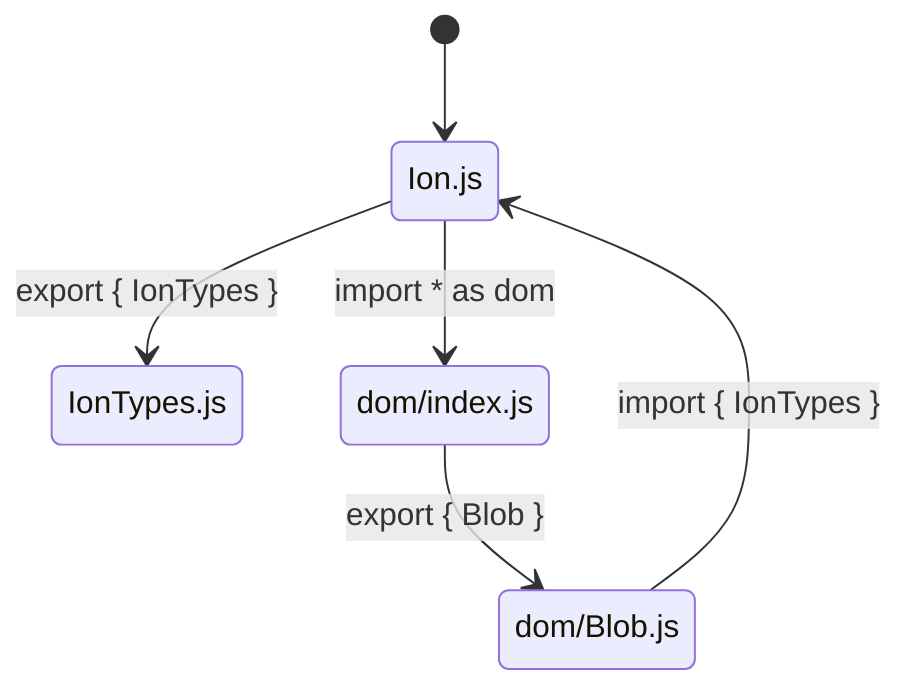

# Retrieval failures

`fixed_v1_header` · `val` split · 20 issues where **no gold file reached the top 10**.

Scanned in issue-number order until the cap, so this set is fixed and reproducible. Regenerate with:

```
python -m eval.failures --strategy fixed_v1_header --n 20 > data/failures.md
```

Fill in the **Cause** at the end of each entry. The distribution of causes is the deliverable — it decides whether the remaining gap is a ranking problem (fixable in Phase 03) or a reasoning problem (Phase 04 tools).


---

## 1 · Issue #13907

**vite build lose some code with special npm package**

| | |
|---|---|
| link | <https://github.com/vitejs/vite/issues/13907> |
| labels | `pending triage` |
| body | 1,945 chars, 1,526 outside code fences |
| names a gold file in the text | no |

### Gold files — and where they actually ranked

| file | file rank | best chunk score | gap to rank 1 |
|---|---|---|---|
| `packages/vite/src/node/plugins/esbuild.ts` | **37** | 0.6900 | 0.0427 |

### What came back instead

| # | file | score |
|---|---|---|
| 1 | `packages/vite/src/node/config.ts` | 0.7327 |
| 2 | `packages/vite/src/node/optimizer/optimizer.ts` | 0.7259 |
| 3 | `packages/vite/src/node/constants.ts` | 0.7250 |
| 4 | `packages/vite/src/node/server/index.ts` | 0.7229 |
| 5 | `packages/vite/src/node/optimizer/index.ts` | 0.7201 |
| 6 | `packages/vite/src/node/nativeConfigCompat.ts` | 0.7192 |
| 7 | `packages/vite/src/node/build.ts` | 0.7191 |
| 8 | `packages/vite/src/node/plugins/resolve.ts` | 0.7151 |
| 9 | `packages/vite/src/node/plugins/importAnalysisBuild.ts` | 0.7147 |
| 10 | `packages/vite/src/node/plugins/importAnalysis.ts` | 0.7128 |

### Would the issue's own words find it?

| term from the gold path | appears in the issue? |
|---|---|
| `esbuild` | no |
| `plugins` | no |

### The report

**Describe the bug**

When I import superagent module, part of js code in the dist was missing after build


**Reproduction**

https://stackblitz.com/edit/vitejs-vite-fek96t?file=main.js

**Steps to reproduce**

1. open two terminals
2. npm run dev
3. npm run preview

The problem will be disappear, if `import request from 'superagent';` is commented out


**System Info**

```shell
System:
    OS: macOS 13.4.1
    CPU: (12) x64 Intel(R) Core(TM) i7-9750H CPU @ 2.60GHz
    Memory: 508.16 MB / 32.00 GB
    Shell: 5.9 - /bin/zsh
  Binaries:
    Node: 14.18.1 - ~/.nvm/versions/node/v14.18.1/bin/node
    Yarn: 1.22.15 - ~/.yarn/bin/yarn
    npm: 8.18.0 - ~/.nvm/versions/node/v14.18.1/bin/npm
  Browsers:
    Chrome: 114.0.5735.198
    Edge: 114.0.1823.67
    Safari: 16.5.2
```


**Used Package Manager**

npm

**Logs**

_No response_

**Validations**

- [X] Follow our [Code of Conduct](https://github.com/vitejs/vite/blob/main/CODE_OF_CONDUCT.md)
- [X] Read the [Contributing Guidelines](https://github.com/vitejs/vite/blob/main/CONTRIBUTING.md).
- [X] Read the [docs](https://vitejs.dev/guide).
- [X] Check that there isn't [already an issue](https://github.com/vitejs/vite/issues) that reports the same bug to avoid creating a duplicate.
- [X] Make sure this is a Vite issue and not a framework-specific issue. For example, if it's a Vue SFC related bug, it should likely be reported to [vuejs/core](https://github.com/vuejs/core) instead.
- [X] Check that this is a concrete bug. For Q&A open a [GitHub Discussion](https://github.com/vitejs/vite/discussions) or join our [Discord Chat Server](https://chat.vitejs.dev/).
- [X] The provided reproduction is a [minimal reproducible example](https://stackoverflow.com/help/minimal-reproducible-example) of the bug.

### Cause

- [ ] **near miss (rank 11-20)** — a reranker over the top 30-50 fixes it
- [ ] **literal miss** — an exact string or identifier was present and unmatched; BM25 would catch it
- [ ] **symptom-vs-cause** — the report names what broke, the fix is upstream of it
- [ ] **vocabulary gap** — user-facing words vs the code's internal identifiers
- [ ] **thin report** — a stack trace or bare repro link; little prose to retrieve on
- [ ] **unfindable** — the fix touched a file this text could not point to

> _notes:_


---

## 2 · Issue #13967

**Silence warning about dynamic import when a dynamically imported module is inlined.**

| | |
|---|---|
| link | <https://github.com/vitejs/vite/issues/13967> |
| labels | `enhancement: pending triage` |
| body | 871 chars, 871 outside code fences |
| names a gold file in the text | no |

### Gold files — and where they actually ranked

| file | file rank | best chunk score | gap to rank 1 |
|---|---|---|---|
| `packages/vite/src/node/plugins/reporter.ts` | not in top 102 | — | — |

### What came back instead

| # | file | score |
|---|---|---|
| 1 | `packages/vite/src/types/commonjs.d.ts` | 0.7280 |
| 2 | `packages/vite/src/types/dynamicImportVars.d.ts` | 0.7214 |
| 3 | `packages/vite/src/node/plugins/importAnalysis.ts` | 0.7091 |
| 4 | `packages/vite/src/node/server/moduleGraph.ts` | 0.7048 |
| 5 | `packages/vite/src/shared/invokeMethods.ts` | 0.7029 |
| 6 | `packages/vite/src/node/optimizer/rolldownDepPlugin.ts` | 0.6994 |
| 7 | `packages/vite/src/node/build.ts` | 0.6992 |
| 8 | `packages/vite/src/node/plugins/dynamicImportVars.ts` | 0.6988 |
| 9 | `packages/vite/src/node/server/mixedModuleGraph.ts` | 0.6986 |
| 10 | `packages/vite/src/node/optimizer/index.ts` | 0.6974 |

### Would the issue's own words find it?

| term from the gold path | appears in the issue? |
|---|---|
| `plugins` | no |
| `reporter` | no |

### The report

**Description**

Since https://github.com/vitejs/vite/pull/12850 a warning is generated when a dynamic import is alongside a static import. 

I dont think it makes sense to show this warning when `inlineDynamicImports` is set to true in the rollupOptions.output. The user is already aware that it wont be moved into a new chunk, because he explicitly used that option.

**Suggested solution**

Disable the warning in such cases.

**Alternative**

_No response_

**Additional context**

_No response_

**Validations**

- [X] Follow our [Code of Conduct](https://github.com/vitejs/vite/blob/main/CODE_OF_CONDUCT.md)
- [X] Read the [Contributing Guidelines](https://github.com/vitejs/vite/blob/main/CONTRIBUTING.md).
- [X] Read the [docs](https://vitejs.dev/guide).
- [X] Check that there isn't already an issue that request the same feature to avoid creating a duplicate.

### Cause

- [ ] **near miss (rank 11-20)** — a reranker over the top 30-50 fixes it
- [ ] **literal miss** — an exact string or identifier was present and unmatched; BM25 would catch it
- [ ] **symptom-vs-cause** — the report names what broke, the fix is upstream of it
- [ ] **vocabulary gap** — user-facing words vs the code's internal identifiers
- [ ] **thin report** — a stack trace or bare repro link; little prose to retrieve on
- [ ] **unfindable** — the fix touched a file this text could not point to

> _notes:_


---

## 3 · Issue #14009

**error when starting vue3 dev server: TypeError: hostnameName.includes is not a function**

| | |
|---|---|
| link | <https://github.com/vitejs/vite/issues/14009> |
| labels | `p3-minor-bug` |
| body | 2,753 chars, 2,042 outside code fences |
| names a gold file in the text | no |

### Gold files — and where they actually ranked

| file | file rank | best chunk score | gap to rank 1 |
|---|---|---|---|
| `packages/vite/src/node/cli.ts` | **13** | 0.6585 | 0.0232 |

### What came back instead

| # | file | score |
|---|---|---|
| 1 | `packages/vite/src/node/server/middlewares/hostCheck.ts` | 0.6817 |
| 2 | `packages/vite/src/node/server/hmr.ts` | 0.6808 |
| 3 | `packages/vite/src/node/server/middlewares/static.ts` | 0.6782 |
| 4 | `packages/vite/src/node/server/index.ts` | 0.6735 |
| 5 | `packages/vite/src/client/client.ts` | 0.6730 |
| 6 | `packages/vite/src/node/plugin.ts` | 0.6723 |
| 7 | `packages/vite/src/node/server/pluginContainer.ts` | 0.6712 |
| 8 | `packages/vite/src/node/server/environment.ts` | 0.6710 |
| 9 | `packages/vite/src/node/server/middlewares/error.ts` | 0.6632 |
| 10 | `packages/vite/src/node/preview.ts` | 0.6611 |

### Would the issue's own words find it?

| term from the gold path | appears in the issue? |
|---|---|
| `cli` | **yes** |
| `node` | **yes** |

### The report

**Describe the bug**

I tried [the Vue 3 quick start guide](https://vuejs.org/guide/quick-start.html#creating-a-vue-application) and started the dev server with `--host 0`, that crashes with ` TypeError: hostnameName.includes is not a function`; omitting the `--host 0` option works fine.

Previously reported as https://github.com/vuejs/core/issues/8901.

**Reproduction**

https://vuejs.org/guide/quick-start.html#creating-a-vue-application

**Steps to reproduce**

```sh
docker pull node:18
docker run -it --rm -p 5173:5173 -v "$PWD:/app" -w /app node:18 bash
npm create vue@3  # accept all defaults
cd vue-project
yarn
yarn run dev --host 0
```

**System Info**

```shell
docker on debian 12


  System:
    OS: Linux 6.1 Debian GNU/Linux 12 (bookworm) 12 (bookworm)
    CPU: (12) x64 Intel(R) Core(TM) i7-8750H CPU @ 2.20GHz
    Memory: 14.42 GB / 23.00 GB
    Container: Yes
    Shell: 5.2.15 - /bin/bash
  Binaries:
    Node: 18.17.0 - /usr/local/bin/node
    Yarn: 1.22.19 - /usr/local/bin/yarn
    npm: 9.6.7 - /usr/local/bin/npm
  npmPackages:
    @vitejs/plugin-vue: ^4.2.3 => 4.2.3 
    vite: ^4.3.9 => 4.4.8
```
```


### Used Package Manager

yarn

### Logs

```
error when starting dev server:
TypeError: hostnameName.includes is not a function
    at resolveServerUrls (file:///app/vue-project/node_modules/vite/dist/node/chunks/dep-75f53616.js:12481:26)
    at process.processTicksAndRejections (node:internal/process/task_queues:95:5)
    at async Object.listen (file:///app/vue-project/node_modules/vite/dist/node/chunks/dep-75f53616.js:64972:39)
    at async CAC.<anonymous> (file:///app/vue-project/node_modules/vite/dist/node/cli.js:756:9)
error Command failed with exit code 1.
info Visit https://yarnpkg.com/en/docs/cli/run for documentation about this command
```

### Validations

- [X] Follow our [Code of Conduct](https://github.com/vitejs/vite/blob/main/CODE_OF_CONDUCT.md)
- [X] Read the [Contributing Guidelines](https://github.com/vitejs/vite/blob/main/CONTRIBUTING.md).
- [X] Read the [docs](https://vitejs.dev/guide).
- [X] Check that there isn't [already an issue](https://github.com/vitejs/vite/issues) that reports the same bug to avoid creating a duplicate.
- [X] Make sure this is a Vite issue and not a framework-specific issue. For example, if it's a Vue SFC related bug, it should likely be reported to [vuejs/core](https://github.com/vuejs/core) instead.
- [X] Check that this is a concrete bug. For Q&A open a [GitHub Discussion](https://github.com/vitejs/vite/discussions) or join our [Discord Chat Server](https://chat.vitejs.dev/).
- [X] The provided reproduction is a [minimal reproducible example](https://stackoverflow.com/help/minimal-reproducible-example) of the bug.
```

### Cause

- [ ] **near miss (rank 11-20)** — a reranker over the top 30-50 fixes it
- [ ] **literal miss** — an exact string or identifier was present and unmatched; BM25 would catch it
- [ ] **symptom-vs-cause** — the report names what broke, the fix is upstream of it
- [ ] **vocabulary gap** — user-facing words vs the code's internal identifiers
- [ ] **thin report** — a stack trace or bare repro link; little prose to retrieve on
- [ ] **unfindable** — the fix touched a file this text could not point to

> _notes:_


---

## 4 · Issue #14010

**SSR crashes from undefined imports**

| | |
|---|---|
| link | <https://github.com/vitejs/vite/issues/14010> |
| labels | `p3-minor-bug`, `feat: ssr` |
| body | 4,725 chars, 1,628 outside code fences |
| names a gold file in the text | no |

### Gold files — and where they actually ranked

| file | file rank | best chunk score | gap to rank 1 |
|---|---|---|---|
| `packages/vite/src/node/ssr/ssrTransform.ts` | **33** | 0.7216 | 0.0421 |

### What came back instead

| # | file | score |
|---|---|---|
| 1 | `packages/vite/src/node/ssr/ssrModuleLoader.ts` | 0.7637 |
| 2 | `packages/vite/src/node/plugins/importAnalysis.ts` | 0.7562 |
| 3 | `packages/vite/src/node/build.ts` | 0.7508 |
| 4 | `packages/vite/src/node/ssr/ssrManifestPlugin.ts` | 0.7488 |
| 5 | `packages/vite/src/client/client.ts` | 0.7480 |
| 6 | `packages/vite/src/node/server/index.ts` | 0.7475 |
| 7 | `packages/vite/src/node/constants.ts` | 0.7445 |
| 8 | `packages/vite/src/module-runner/importMetaResolver.ts` | 0.7430 |
| 9 | `packages/vite/src/shared/ssrTransform.ts` | 0.7430 |
| 10 | `packages/vite/src/node/plugins/importAnalysisBuild.ts` | 0.7423 |

### Would the issue's own words find it?

| term from the gold path | appears in the issue? |
|---|---|
| `ssr` | **yes** |
| `ssr transform` | no |
| `ssrtransform` | no |

### The report

**Describe the bug**

During SSR, certain imports are erroneously `undefined` at runtime, resulting in a crash. It seems this happens in some instances of (perfectly valid) cyclic imports.

**Reproduction**

https://stackblitz.com/github/rtsao/vite-bug-repro-undefined-ssr-imports

**Steps to reproduce**

Open https://stackblitz.com/github/rtsao/vite-bug-repro-undefined-ssr-imports

Notice the error in console:
```
[vite] Error when evaluating SSR module /home/projects/xorinpoxx.github/ssr.mjs: failed to import "/lib/index.mjs"
|- TypeError: __vite_ssr_import_0__.getB is not a function
    at eval (/home/projects/xorinpoxx.github/lib/a.mjs:9:44)
    at async instantiateModule (file:///home/projects/xorinpoxx.github/node_modules/.pnpm/vite@4.4.8/node_modules/vite/dist/node/chunks/dep-75f53616.js:55977:9)
```

Alternatively, clone https://github.com/rtsao/vite-bug-repro-undefined-ssr-imports and run `pnpm install && pnpm dev`

**System Info**

```shell
System:
    OS: macOS 13.5
    CPU: (10) arm64 Apple M1 Max
    Memory: 14.61 GB / 64.00 GB
    Shell: 5.9 - /bin/zsh
  Binaries:
    Node: 16.16.0 - ~/Library/Caches/fnm_multishells/61346_1691011041637/bin/node
    npm: 8.11.0 - /opt/uber/bin/npm
    pnpm: 8.6.11 - ~/Library/Caches/fnm_multishells/61346_1691011041637/bin/pnpm
  Browsers:
    Chrome: 115.0.5790.114
    Safari: 16.6
  npmPackages:
    vite: ^4.4.8 => 4.4.8
```


**Used Package Manager**

pnpm

**Logs**

<details>
<summary>Click to expand!</summary>

```shell
~/projects/xorinpoxx.github
❯ pnpm install && pnpm run dev
Lockfile is up to date, resolution step is skipped
Packages: +66
++++++++++++++++++++++++++++++++++++++++++++++++++++++++++++++++++

dependencies:
+ express 4.18.2
+ vite 4.4.8

Progress: resolved 66, reused 0, downloaded 66, added 66, done
Done in 3.1s

> vite-bug@ dev /home/projects/xorinpoxx.github
> node server.mjs

http://localhost:5173
2:21:08 PM [vite] Error when evaluating SSR module /lib/a.mjs:
|- TypeError: __vite_ssr_import_0__.getB is not a function
    at eval (/home/projects/xorinpoxx.github/lib/a.mjs:9:44)
    at async instantiateModule (file:///home/projects/xorinpoxx.github/node_modules/.pnpm/vite@4.4.8/node_modules/vite/dist/node/chunks/dep-75f53616.js:55977:9)

2:21:08 PM [vite] Error when evaluating SSR module /lib/b.mjs: failed to import "/lib/a.mjs"
|- TypeError: __vite_ssr_import_0__.getB is not a function
    at eval (/home/projects/xorinpoxx.github/lib/a.mjs:9:44)
    at async instantiateModule (file:///home/projects/xorinpoxx.github/node_modules/.pnpm/vite@4.4.8/node_modules/vite/dist/node/chunks/dep-75f53616.js:55977:9)

2:21:08 PM [vite] Error when evaluating SSR module /lib/index.mjs: failed to import "/lib/b.mjs"
|- TypeError: __vite_ssr_import_0__.getB is not a function
    at eval (/home/projects/xorinpoxx.github/lib/a.mjs:9:44)
    at async instantiateModule (file:///home/projects/xorinpoxx.github/node_modules/.pnpm/vite@4.4.8/node_modules/vite/dist/node/chunks/dep-75f53616.js:55977:9)

2:21:08 PM [vite] Error when evaluating SSR module /home/projects/xorinpoxx.github/ssr.mjs: failed to import "/lib/index.mjs"
|- TypeError: __vite_ssr_import_0__.getB is not a function
    at eval (/home/projects/xorinpoxx.github/lib/a.mjs:9:44)
    at async instantiateModule (file:///home/projects/xorinpoxx.github/node_modules/.pnpm/vite@4.4.8/node_modules/vite/dist/node/chunks/dep-75f53616.js:55977:9)

TypeError: __vite_ssr_import_0__.getB is not a function
    at /home/projects/xorinpoxx.github/lib/a.mjs:5:22
    at async instantiateModule (file:///home/projects/xorinpoxx.github/node_modules/.pnpm/vite@4.4.8/node_modules/vite/dist/node/chunks/dep-75f53616.js:55977:9)

```
</details>

**Validations**

- [X] Follow our [Code of Conduct](https://github.com/vitejs/vite/blob/main/CODE_OF_CONDUCT.md)
- [X] Read the [Contributing Guidelines](https://github.com/vitejs/vite/blob/main/CONTRIBUTING.md).
- [X] Read the [docs](https://vitejs.dev/guide).
- [X] Check that there isn't [already an issue](https://github.com/vitejs/vite/issues) that reports the same bug to avoid creating a duplicate.
- [X] Make sure this is a Vite issue and not a framework-specific issue. For example, if it's a Vue SFC related bug, it should likely be reported to [vuejs/core](https://github.com/vuejs/core) instead.
- [X] Check that this is a concrete bug. For Q&A open a [GitHub Discussion](https://github.com/vitejs/vite/discussions) or join our [Discord Chat Server](https://chat.vitejs.dev/).
- [X] The provided reproduction is a [minimal reproducible example](https://stackoverflow.com/help/minimal-reproducible-example) of the bug.

### Cause

- [ ] **near miss (rank 11-20)** — a reranker over the top 30-50 fixes it
- [ ] **literal miss** — an exact string or identifier was present and unmatched; BM25 would catch it
- [ ] **symptom-vs-cause** — the report names what broke, the fix is upstream of it
- [ ] **vocabulary gap** — user-facing words vs the code's internal identifiers
- [ ] **thin report** — a stack trace or bare repro link; little prose to retrieve on
- [ ] **unfindable** — the fix touched a file this text could not point to

> _notes:_


---

## 5 · Issue #14048

**Vite SSR Imports not loading classes correctly - constructors not loaded**

| | |
|---|---|
| link | <https://github.com/vitejs/vite/issues/14048> |
| labels | `contribution welcome`, `p2-nice-to-have`, `feat: ssr` |
| body | 41,621 chars, 1,622 outside code fences |
| names a gold file in the text | no |

### Gold files — and where they actually ranked

| file | file rank | best chunk score | gap to rank 1 |
|---|---|---|---|
| `packages/vite/src/node/ssr/ssrTransform.ts` | **42** | 0.7296 | 0.0534 |

### What came back instead

| # | file | score |
|---|---|---|
| 1 | `packages/vite/src/node/plugins/importAnalysis.ts` | 0.7830 |
| 2 | `packages/vite/src/node/plugins/importAnalysisBuild.ts` | 0.7735 |
| 3 | `packages/vite/src/node/build.ts` | 0.7726 |
| 4 | `packages/vite/src/node/server/pluginContainer.ts` | 0.7668 |
| 5 | `packages/vite/src/client/client.ts` | 0.7630 |
| 6 | `packages/vite/src/node/ssr/ssrModuleLoader.ts` | 0.7626 |
| 7 | `packages/vite/src/node/optimizer/index.ts` | 0.7618 |
| 8 | `packages/vite/src/node/plugins/importMetaGlob.ts` | 0.7609 |
| 9 | `packages/vite/src/node/plugins/esbuild.ts` | 0.7586 |
| 10 | `packages/vite/src/node/ssr/ssrManifestPlugin.ts` | 0.7498 |

### Would the issue's own words find it?

| term from the gold path | appears in the issue? |
|---|---|
| `ssr` | **yes** |
| `ssr transform` | no |
| `ssrtransform` | no |

### The report

**Describe the bug**

I'm trying to use a class in a Vite + SvelteKit project with TypeScript enabled. However, when I try to use a class and construct it in other places, while IntelliSense/LSPs don't throw any errors, when building/developing, the following error is outputted:
```
11:00:08 AM [vite] Error when evaluating SSR module /src/lib/core/games/chess/chess.ts:
|- TypeError: __vite_ssr_import_0__.GameMetadata is not a constructor
    at eval (/home/ramendev/projects/just-games/src/lib/core/games/chess/chess.ts:5:15)
    at async instantiateModule (file:///home/ramendev/projects/just-games/node_modules/vite/dist/node/chunks/dep-df561101.js:55974:9)

*other errors caused when importing the chess.ts file*

11:00:08 AM [vite] Error when evaluating SSR module /src/routes/+page.svelte: failed to import "/src/lib/components/games/GamesCarousel.svelte"
|- TypeError: __vite_ssr_import_0__.GameMetadata is not a constructor
    at eval (/home/ramendev/projects/just-games/src/lib/core/games/chess/chess.ts:5:15)
    at async instantiateModule (file:///home/ramendev/projects/just-games/node_modules/vite/dist/node/chunks/dep-df561101.js:55974:9)

Internal server error: __vite_ssr_import_0__.GameMetadata is not a constructor
      at eval (/home/ramendev/projects/just-games/src/lib/core/games/chess/chess.ts:5:15)
      at async instantiateModule (file:///home/ramendev/projects/just-games/node_modules/vite/dist/node/chunks/dep-df561101.js:55974:9)
TypeError: __vite_ssr_import_0__.GameMetadata is not a constructor
    at eval (/home/ramendev/projects/just-games/src/lib/core/games/chess/chess.ts:5:15)
    at async instantiateModule (file:///home/ramendev/projects/just-games/node_modules/vite/dist/node/chunks/dep-df561101.js:55974:9)

```

The class in question is defined as follows:
`src/lib/core/games.ts`
```ts
export class GameMetadata {
	name: string;
	aka: string;
	description: string;
	jpName: string;

	constructor(name: string, aka: string, description: string, jpName: string) {
		this.name = name;
		this.aka = aka;
		this.description = description;
		this.jpName = jpName;
	}
```

`src/lib/core/games/chess/chess.ts`
```ts
import { GameMetadata } from "../../game";

export const chess = new GameMetadata(
	"chess",
	'...',
	"...",
	"西洋将棋"
);
```

**Reproduction**

https://github.com/developer-ramen/just-games

**Steps to reproduce**

Clone the repo, followed by `npm install` and `npm run dev`

**System Info**

```shell
System:
    OS: Linux 5.15 Ubuntu 22.04.2 LTS 22.04.2 LTS (Jammy Jellyfish)
    CPU: (8) x64 Intel(R) Core(TM) i7-8665U CPU @ 1.90GHz
    Memory: 5.39 GB / 7.67 GB
    Container: Yes
    Shell: 5.8.1 - /usr/bin/zsh
  Binaries:
    Node: 18.17.0 - /usr/local/bin/node
    npm: 9.6.7 - /usr/local/bin/npm
  npmPackages:
    vite: ^4.4.2 => 4.4.9
```


**Used Package Manager**

npm

**Logs**

<details>
<summary>Logs from runnning `vite-build-debug`</summary>
```shell
  vite:config bundled config file loaded in 675.06ms +0ms
  vite:vite-plugin-svelte adding bare svelte packages to optimizeDeps.include: svelte/animate, svelte/easing, svelte/internal, svelte/motion, svelte/store, svelte/transition, svelte, svelte/internal/disclose-version  +0ms
  vite:vite-plugin-svelte extra config for dependencies generated by vitefu {
  optimizeDeps: { include: [], exclude: [] },
  ssr: { noExternal: [], external: [] }
} +5ms
  vite:vite-plugin-svelte post-processed extra config for dependencies {
  optimizeDeps: { include: [], exclude: [] },
  ssr: { noExternal: [], external: [] }
} +1ms
  vite:vite-plugin-svelte enabling "experimental.hmrPartialAccept" in vite config +1ms
  vite:vite-plugin-svelte additional vite config {
  resolve: {
    dedupe: [
      'svelte/animate',
      'svelte/easing',
      'svelte/internal',
      'svelte/motion',
      'svelte/ssr',
      'svelte/store',
      'svelte/transition',
      'svelte',
      'svelte/internal/disclose-version',
      'svelte-hmr/runtime/hot-api-esm.js',
      'svelte-hmr/runtime/proxy-adapter-dom.js',
      'svelte-hmr'
    ],
    conditions: [ 'svelte' ]
  },
  optimizeDeps: {
    include: [
      'svelte/animate',
      'svelte/easing',
      'svelte/internal',
      'svelte/motion',
      'svelte/store',
      'svelte/transition',
      'svelte',
      'svelte/internal/disclose-version'
    ],
    exclude: [ 'svelte-hmr' ]
  },
  ssr: { external: [], noExternal: [ 'svelte', /^svelte\// ] },
  experimental: { hmrPartialAccept: true }
} +0ms
  vite:vite-plugin-svelte resolved options {
  hot: false,
  compilerOptions: { css: 'external', dev: false, hydratable: true },
  extensions: [ '.svelte' ],
  emitCss: true,
  prebundleSvelteLibraries: false,
  configFile: false,
  preprocess: [
    {
      markup: [AsyncFunction: markup],
      script: [AsyncFunction: script],
      style: [AsyncFunction: style]
    },
    { script: [Function: script], markup: [Function: markup] }
  ],
  onwarn: undefined,
  root: '/home/ramendev/projects/just-games',
  isBuild: true,
  isServe: false,
  isDebug: true,
  isProduction: true,
  stats: VitePluginSvelteStats {}
} +53ms

  vite:config using resolved config: {
  vite:config   plugins: [
  vite:config     'vite:optimized-deps-build',
  vite:config     'vite:build-metadata',
  vite:config     'vite:watch-package-data',
  vite:config     'vite:pre-alias',
  vite:config     'alias',
  vite:config     'vite-plugin-svelte',
  vite:config     'vite:modulepreload-polyfill',
  vite:config     'vite:resolve',
  vite:config     'vite:html-inline-proxy',
  vite:config     'vite:css',
  vite:config     'vite:esbuild',
  vite:config     'vite:json',
  vite:config     'vite:wasm-helper',
  vite:config     'vite:worker',
  vite:config     'vite:asset',
  vite:config     'vite-plugin-sveltekit-setup',
  vite:config     'vite-plugin-sveltekit-virtual-modules',
  vite:config     'vite-plugin-sveltekit-guard',
  vite:config     'vite-plugin-sveltekit-compile',
  vite:config     'vite:wasm-fallback',
  vite:config     'vite:define',
  vite:config     'vite:css-post',
  vite:config     'vite:build-html',
  vite:config     'vite:worker-import-meta-url',
  vite:config     'vite:asset-import-meta-url',
  vite:config     'vite:force-systemjs-wrap-complete',
  vite:config     'commonjs',
  vite:config     'vite:data-uri',
  vite:config     'vite:dynamic-import-vars',
  vite:config     'vite:import-glob',
  vite:config     'vite:build-import-analysis',
  vite:config     'vite:esbuild-transpile',
  vite:config     'vite:manifest',
  vite:config     'vite:reporter',
  vite:config     'vite:load-fallback'
  vite:config   ],
  vite:config   test: { include: [ 'src/**/*.{test,spec}.{js,ts}' ] },
  vite:config   optimizeDeps: {
  vite:config     disabled: false,
  vite:config     include: [
  vite:config       'svelte/animate',
  vite:config       'svelte/easing',
  vite:config       'svelte/internal',
  vite:config       'svelte/motion',
  vite:config       'svelte/store',
  vite:config       'svelte/transition',
  vite:config       'svelte',
  vite:config       'svelte/internal/disclose-version'
  vite:config     ],
  vite:config     exclude: [ 'svelte-hmr', '@sveltejs/kit', '$app', '$env' ],
  vite:config     esbuildOptions: { preserveSymlinks: false }
  vite:config   },
  vite:config   build: {
  vite:config     target: 'node16.14',
  vite:config     cssTarget: 'node16.14',
  vite:config     outDir: '/home/ramendev/projects/just-games/.svelte-kit/output/server',
  vite:config     assetsDir: 'assets',
  vite:config     assetsInlineLimit: 4096,
  vite:config     cssCodeSplit: true,
  vite:config     sourcemap: false,
  vite:config     rollupOptions: {
  vite:config       input: [Object],
  vite:config       output: [Object],
  vite:config       preserveEntrySignatures: 'strict'
  vite:config     },
  vite:config     minify: false,
  vite:config     terserOptions: {},
  vite:config     write: true,
  vite:config     emptyOutDir: null,
  vite:config     copyPublicDir: false,
  vite:config     manifest: 'vite-manifest.json',
  vite:config     lib: false,
  vite:config     ssr: true,
  vite:config     ssrManifest: false,
  vite:config     ssrEmitAssets: true,
  vite:config     reportCompressedSize: true,
  vite:config     chunkSizeWarningLimit: 500,
  vite:config     watch: null,
  vite:config     cssMinify: true,
  vite:config     commonjsOptions: { include: [Array], extensions: [Array] },
  vite:config     dynamicImportVarsOptions: { warnOnError: true, exclude: [Array] },
  vite:config     modulePreload: { polyfill: true }
  vite:config   },
  vite:config   resolve: {
  vite:config     mainFields: [ 'svelte', 'module', 'jsnext:main', 'jsnext' ],
  vite:config     browserField: true,
  vite:config     conditions: [ 'svelte' ],
  vite:config     extensions: [
  vite:config       '.mjs',  '.js',
  vite:config       '.mts',  '.ts',
  vite:config       '.jsx',  '.tsx',
  vite:config       '.json'
  vite:config     ],
  vite:config     dedupe: [
  vite:config       'svelte/animate',
  vite:config       'svelte/easing',
  vite:config       'svelte/internal',
  vite:config       'svelte/motion',
  vite:config       'svelte/ssr',
  vite:config       'svelte/store',
  vite:config       'svelte/transition',
  vite:config       'svelte',
  vite:config       'svelte/internal/disclose-version',
  vite:config       'svelte-hmr/runtime/hot-api-esm.js',
  vite:config       'svelte-hmr/runtime/proxy-adapter-dom.js',
  vite:config       'svelte-hmr'
  vite:config     ],
  vite:config     preserveSymlinks: false,
  vite:config     alias: [ [Object], [Object], [Object], [Object], [Object] ]
  vite:config   },
  vite:config   ssr: {
  vite:config     format: 'esm',
  vite:config     target: 'node',
  vite:config     external: [],
  vite:config     noExternal: [ 'svelte', /^svelte\//, 'esm-env', '@sveltejs/kit' ],
  vite:config     optimizeDeps: { disabled: true, esbuildOptions: [Object] }
  vite:config   },
  vite:config   experimental: { importGlobRestoreExtension: false, hmrPartialAccept: true },
  vite:config   root: '/home/ramendev/projects/just-games',
  vite:config   server: {
  vite:config     preTransformRequests: true,
  vite:config     cors: { preflightContinue: true },
  vite:config     fs: { strict: true, allow: [Array], deny: [Array] },
  vite:config     sourcemapIgnoreList: [Function: sourcemapIgnoreList],
  vite:config     watch: { ignored: [Array] },
  vite:config     middlewareMode: false
  vite:config   },
  vite:config   preview: {
  vite:config     port: undefined,
  vite:config     strictPort: undefined,
  vite:config     host: undefined,
  vite:config     https: undefined,
  vite:config     open: undefined,
  vite:config     proxy: undefined,
  vite:config     cors: { preflightContinue: true },
  vite:config     headers: undefined
  vite:config   },
  vite:config   define: {
  vite:config     __SVELTEKIT_ADAPTER_NAME__: '"@sveltejs/adapter-netlify"',
  vite:config     __SVELTEKIT_APP_VERSION_FILE__: '"_app/version.json"',
  vite:config     __SVELTEKIT_APP_VERSION_POLL_INTERVAL__: '0',
  vite:config     __SVELTEKIT_DEV__: 'false',
  vite:config     __SVELTEKIT_EMBEDDED__: 'false'
  vite:config   },
  vite:config   base: '/',
  vite:config   publicDir: '/home/ramendev/projects/just-games/static',
  vite:config   worker: {
  vite:config     format: 'iife',
  vite:config     plugins: [
  vite:config       'vite:optimized-deps-build',
  vite:config       'vite:build-metadata',
  vite:config       'vite:watch-package-data',
  vite:config       'vite:pre-alias',
  vite:config       'alias',
  vite:config       'vite:modulepreload-polyfill',
  vite:config       'vite:resolve',
  vite:config       'vite:html-inline-proxy',
  vite:config       'vite:css',
  vite:config       'vite:esbuild',
  vite:config       'vite:json',
  vite:config       'vite:wasm-helper',
  vite:config       'vite:worker',
  vite:config       'vite:asset',
  vite:config       'vite:wasm-fallback',
  vite:config       'vite:define',
  vite:config       'vite:css-post',
  vite:config       'vite:build-html',
  vite:config       'vite:worker-import-meta-url',
  vite:config       'vite:asset-import-meta-url',
  vite:config       'vite:force-systemjs-wrap-complete',
  vite:config       'commonjs',
  vite:config       'vite:data-uri',
  vite:config       'vite:worker-post',
  vite:config       'vite:dynamic-import-vars',
  vite:config       'vite:import-glob',
  vite:config       'vite:build-import-analysis',
  vite:config       'vite:esbuild-transpile',
  vite:config       'vite:load-fallback'
  vite:config     ],
  vite:config     rollupOptions: { output: [Object] },
  vite:config     getSortedPlugins: [Function: getSortedPlugins],
  vite:config     getSortedPluginHooks: [Function: getSortedPluginHooks]
  vite:config   },
  vite:config   configFile: '/home/ramendev/projects/just-games/vite.config.ts',
  vite:config   configFileDependencies: [ '/home/ramendev/projects/just-games/vite.config.ts' ],
  vite:config   inlineConfig: {
  vite:config     root: undefined,
  vite:config     base: undefined,
  vite:config     mode: undefined,
  vite:config     configFile: undefined,
  vite:config     logLevel: undefined,
  vite:config     clearScreen: undefined,
  vite:config     optimizeDeps: { force: undefined },
  vite:config     build: {}
  vite:config   },
  vite:config   rawBase: '/',
  vite:config   cacheDir: '/home/ramendev/projects/just-games/node_modules/.vite',
  vite:config   command: 'build',
  vite:config   mode: 'production',
  vite:config   isWorker: false,
  vite:config   mainConfig: null,
  vite:config   isProduction: true,
  vite:config   css: undefined,
  vite:config   esbuild: { jsxDev: false },
  vite:config   envDir: '/home/ramendev/projects/just-games',
  vite:config   env: { BASE_URL: '/', MODE: 'production', DEV: false, PROD: true },
  vite:config   assetsInclude: [Function: assetsInclude],
  vite:config   logger: {
  vite:config     hasWarned: true,
  vite:config     info: [Function: info],
  vite:config     warn: [Function: warn],
  vite:config     warnOnce: [Function: warnOnce],
  vite:config     error: [Function: error],
  vite:config     clearScreen: [Function: clearScreen],
  vite:config     hasErrorLogged: [Function: hasErrorLogged]
  vite:config   },
  vite:config   packageCache: Map(1) {
  vite:config     'fnpd_/home/ramendev/projects/just-games' => {
  vite:config       dir: '/home/ramendev/projects/just-games',
  vite:config       data: [Object],
  vite:config       hasSideEffects: [Function: hasSideEffects],
  vite:config       webResolvedImports: {},
  vite:config       nodeResolvedImports: {},
  vite:config       setResolvedCache: [Function: setResolvedCache],
  vite:config       getResolvedCache: [Function: getResolvedCache]
  vite:config     },
  vite:config     set: [Function (anonymous)]
  vite:config   },
  vite:config   createResolver: [Function: createResolver],
  vite:config   appType: 'spa',
  vite:config   getSortedPlugins: [Function: getSortedPlugins],
  vite:config   getSortedPluginHooks: [Function: getSortedPluginHooks]
  vite:config } +77ms
vite v4.4.9 building SSR bundle for production...
transforming (1) node_modules/@sveltejs/kit/src/runtime/server/index.js  vite:vite-plugin-svelte transform returns compiled js for /home/ramendev/projects/just-games/src/routes/+layout.svelte +122ms
  vite:vite-plugin-svelte transform returns compiled js for /home/ramendev/projects/just-games/src/routes/+error.svelte +280ms
  vite:vite-plugin-svelte resolveId resolved virtual css module /home/ramendev/projects/just-games/src/routes/+error.svelte?svelte&type=style&lang.css +6ms
  vite:vite-plugin-svelte load returns css for /home/ramendev/projects/just-games/src/routes/+error.svelte +1ms
  vite:vite-plugin-svelte transform returns compiled js for /home/ramendev/projects/just-games/src/routes/+page.svelte +21ms
  vite:vite-plugin-svelte transform returns compiled js for /home/ramendev/projects/just-games/src/routes/games/+page.svelte +12ms
  vite:vite-plugin-svelte transform returns compiled js for /home/ramendev/projects/just-games/src/routes/login/+page.svelte +23ms
  vite:vite-plugin-svelte transform returns compiled js for /home/ramendev/projects/just-games/src/routes/signup/+page.svelte +10ms
  vite:vite-plugin-svelte transform returns compiled js for /home/ramendev/projects/just-games/src/routes/resources/+page.svelte +31ms
transforming (11) src/routes/resources/+page.svelte  vite:vite-plugin-svelte transform returns compiled js for /home/ramendev/projects/just-games/src/routes/about/+page.svelte +8ms
  vite:esbuild 537.78ms tsconfck init /home/ramendev/projects/just-games +0ms
  vite:vite-plugin-svelte transform returns compiled js for /home/ramendev/projects/just-games/src/lib/components/NavBar.svelte +130ms
  vite:vite-plugin-svelte resolveId resolved virtual css module /home/ramendev/projects/just-games/src/lib/components/NavBar.svelte?svelte&type=style&lang.css +8ms
  vite:vite-plugin-svelte transform returns compiled js for /home/ramendev/projects/just-games/src/lib/components/Footer.svelte +31ms
  vite:vite-plugin-svelte resolveId resolved virtual css module /home/ramendev/projects/just-games/src/lib/components/Footer.svelte?svelte&type=style&lang.css +3ms
  vite:vite-plugin-svelte transform returns compiled js for /home/ramendev/projects/just-games/.svelte-kit/generated/root.svelte +70ms
  vite:vite-plugin-svelte transform returns compiled js for /home/ramendev/projects/just-games/src/lib/components/home/GamePageButton.svelte +75ms
  vite:vite-plugin-svelte transform returns compiled js for /home/ramendev/projects/just-games/src/lib/components/games/GamesCarousel.svelte +52ms
  vite:vite-plugin-svelte resolveId resolved virtual css module /home/ramendev/projects/just-games/src/lib/components/games/GamesCarousel.svelte?svelte&type=style&lang.css +5ms
  vite:vite-plugin-svelte transform returns compiled js for /home/ramendev/projects/just-games/src/lib/components/home/HomeBanner.svelte +11ms
  vite:vite-plugin-svelte transform returns compiled js for /home/ramendev/projects/just-games/src/lib/components/games/GamesContent.svelte +24ms
  vite:vite-plugin-svelte transform returns compiled js for /home/ramendev/projects/just-games/src/lib/components/WipBanner.svelte +20ms
  vite:vite-plugin-svelte resolveId resolved virtual css module /home/ramendev/projects/just-games/src/lib/components/WipBanner.svelte?svelte&type=style&lang.css +5ms
transforming (26) node_modules/@sveltejs/kit/src/runtime/server/endpoint.js  vite:vite-plugin-svelte load returns css for /home/ramendev/projects/just-games/src/lib/components/NavBar.svelte +188ms
  vite:vite-plugin-svelte load returns css for /home/ramendev/projects/just-games/src/lib/components/Footer.svelte +5ms
  vite:vite-plugin-svelte load returns css for /home/ramendev/projects/just-games/src/lib/components/games/GamesCarousel.svelte +33ms
transforming (45) node_modules/svelte/src/runtime/internal/dom.js  vite:vite-plugin-svelte load returns css for /home/ramendev/projects/just-games/src/lib/components/WipBanner.svelte +109ms
  vite:vite-plugin-svelte transform returns compiled js for /home/ramendev/projects/just-games/src/lib/components/NameLabel.svelte +168ms
  vite:vite-plugin-svelte transform returns compiled js for /home/ramendev/projects/just-games/src/lib/components/NavButton.svelte +45ms
  vite:vite-plugin-svelte transform returns compiled js for /home/ramendev/projects/just-games/src/lib/components/games/CarouselGameItem.svelte +28ms
  vite:vite-plugin-svelte transform returns compiled js for /home/ramendev/projects/just-games/src/lib/components/games/GameCarouselHelpText.svelte +28ms
  vite:vite-plugin-svelte resolveId resolved virtual css module /home/ramendev/projects/just-games/src/lib/components/games/GameCarouselHelpText.svelte?svelte&type=style&lang.css +1ms
  vite:vite-plugin-svelte transform returns compiled js for /home/ramendev/projects/just-games/src/lib/components/games/search/GoogleImitationTitle.svelte +378ms
transforming (65) src/lib/components/games/search/GoogleImitationTitle.svelte  vite:vite-plugin-svelte transform returns compiled js for /home/ramendev/projects/just-games/src/lib/components/games/search/GoogleBannerImitation.svelte +30ms
  vite:vite-plugin-svelte transform returns compiled js for /home/ramendev/projects/just-games/src/lib/components/games/search/SearchSection.svelte +25ms
  vite:vite-plugin-svelte load returns css for /home/ramendev/projects/just-games/src/lib/components/games/GameCarouselHelpText.svelte +3ms
transforming (83) node_modules/svelte/src/shared/utils/names.js  vite:vite-plugin-svelte transform returns compiled js for /home/ramendev/projects/just-games/src/lib/components/games/search/SearchBar.svelte +434ms
  vite:vite-plugin-svelte transform returns compiled js for /home/ramendev/projects/just-games/src/lib/components/games/search/SearchResults.svelte +41ms
transforming (100) src/lib/core/game.ts  vite:vite-plugin-svelte transform returns compiled js for /home/ramendev/projects/just-games/src/lib/components/games/search/SearchResult.svelte +190ms
"slice" is imported from external module "lodash" but never used in "src/lib/components/games/search/GoogleBannerImitation.svelte", "src/lib/core/game.ts", "src/lib/components/games/GamesCarousel.svelte" and "src/routes/+error.svelte".
✓ 109 modules transformed.
  vite:vite-plugin-svelte:stats ssr compile done.
  vite:vite-plugin-svelte:stats package         files    time      avg
  vite:vite-plugin-svelte:stats svelte-games       26   0.36s   13.7ms +0ms
  vite:config bundled config file loaded in 17.58ms +3s
  vite:vite-plugin-svelte adding bare svelte packages to optimizeDeps.include: svelte/animate, svelte/easing, svelte/internal, svelte/motion, svelte/store, svelte/transition, svelte, svelte/internal/disclose-version  +534ms
  vite:vite-plugin-svelte extra config for dependencies generated by vitefu {
  optimizeDeps: { include: [], exclude: [] },
  ssr: { noExternal: [], external: [] }
} +3ms
  vite:vite-plugin-svelte post-processed extra config for dependencies {
  optimizeDeps: { include: [], exclude: [] },
  ssr: { noExternal: [], external: [] }
} +1ms
  vite:vite-plugin-svelte enabling "experimental.hmrPartialAccept" in vite config +0ms
  vite:vite-plugin-svelte additional vite config {
  resolve: {
    dedupe: [
      'svelte/animate',
      'svelte/easing',
      'svelte/internal',
      'svelte/motion',
      'svelte/ssr',
      'svelte/store',
      'svelte/transition',
      'svelte',
      'svelte/internal/disclose-version',
      'svelte-hmr/runtime/hot-api-esm.js',
      'svelte-hmr/runtime/proxy-adapter-dom.js',
      'svelte-hmr'
    ],
    conditions: [ 'svelte' ]
  },
  optimizeDeps: {
    include: [
      'svelte/animate',
      'svelte/easing',
      'svelte/internal',
      'svelte/motion',
      'svelte/store',
      'svelte/transition',
      'svelte',
      'svelte/internal/disclose-version'
    ],
    exclude: [ 'svelte-hmr' ]
  },
  ssr: { external: [], noExternal: [ 'svelte', /^svelte\// ] },
  experimental: { hmrPartialAccept: true }
} +0ms
  vite:vite-plugin-svelte resolved options {
  hot: false,
  compilerOptions: { css: 'external', dev: false, hydratable: true },
  extensions: [ '.svelte' ],
  emitCss: true,
  prebundleSvelteLibraries: false,
  configFile: false,
  preprocess: [
    {
      markup: [AsyncFunction: markup],
      script: [AsyncFunction: script],
      style: [AsyncFunction: style]
    },
    { script: [Function: script], markup: [Function: markup] }
  ],
  onwarn: undefined,
  root: '/home/ramendev/projects/just-games',
  isBuild: true,
  isServe: false,
  isDebug: true,
  isProduction: true,
  stats: VitePluginSvelteStats {}
} +6ms

  vite:config using resolved config: {
  vite:config   plugins: [
  vite:config     'vite:optimized-deps-build',
  vite:config     'vite:build-metadata',
  vite:config     'vite:watch-package-data',
  vite:config     'vite:pre-alias',
  vite:config     'alias',
  vite:config     'vite-plugin-svelte',
  vite:config     'vite:modulepreload-polyfill',
  vite:config     'vite:resolve',
  vite:config     'vite:html-inline-proxy',
  vite:config     'vite:css',
  vite:config     'vite:esbuild',
  vite:config     'vite:json',
  vite:config     'vite:wasm-helper',
  vite:config     'vite:worker',
  vite:config     'vite:asset',
  vite:config     'vite-plugin-sveltekit-setup',
  vite:config     'vite-plugin-sveltekit-virtual-modules',
  vite:config     'vite-plugin-sveltekit-guard',
  vite:config     'vite-plugin-sveltekit-compile',
  vite:config     'vite:wasm-fallback',
  vite:config     'vite:define',
  vite:config     'vite:css-post',
  vite:config     'vite:build-html',
  vite:config     'vite:worker-import-meta-url',
  vite:config     'vite:asset-import-meta-url',
  vite:config     'vite:force-systemjs-wrap-complete',
  vite:config     'commonjs',
  vite:config     'vite:data-uri',
  vite:config     'vite:dynamic-import-vars',
  vite:config     'vite:import-glob',
  vite:config     'vite:build-import-analysis',
  vite:config     'vite:esbuild-transpile',
  vite:config     'vite:terser',
  vite:config     'vite:manifest',
  vite:config     'vite:reporter',
  vite:config     'vite:load-fallback'
  vite:config   ],
  vite:config   test: { include: [ 'src/**/*.{test,spec}.{js,ts}' ] },
  vite:config   optimizeDeps: {
  vite:config     disabled: false,
  vite:config     include: [
  vite:config       'svelte/animate',
  vite:config       'svelte/easing',
  vite:config       'svelte/internal',
  vite:config       'svelte/motion',
  vite:config       'svelte/store',
  vite:config       'svelte/transition',
  vite:config       'svelte',
  vite:config       'svelte/internal/disclose-version'
  vite:config     ],
  vite:config     exclude: [ 'svelte-hmr', '@sveltejs/kit', '$app', '$env' ],
  vite:config     esbuildOptions: { preserveSymlinks: false }
  vite:config   },
  vite:config   configFile: '/home/ramendev/projects/just-games/vite.config.ts',
  vite:config   mode: 'production',
  vite:config   build: {
  vite:config     target: [ 'es2020', 'edge88', 'firefox78', 'chrome87', 'safari14' ],
  vite:config     cssTarget: [ 'es2020', 'edge88', 'firefox78', 'chrome87', 'safari14' ],
  vite:config     outDir: '/home/ramendev/projects/just-games/.svelte-kit/output/client',
  vite:config     assetsDir: 'assets',
  vite:config     assetsInlineLimit: 4096,
  vite:config     cssCodeSplit: true,
  vite:config     sourcemap: false,
  vite:config     rollupOptions: {
  vite:config       input: [Object],
  vite:config       output: [Object],
  vite:config       preserveEntrySignatures: 'strict'
  vite:config     },
  vite:config     minify: 'esbuild',
  vite:config     terserOptions: {},
  vite:config     write: true,
  vite:config     emptyOutDir: null,
  vite:config     copyPublicDir: true,
  vite:config     manifest: 'vite-manifest.json',
  vite:config     lib: false,
  vite:config     ssr: false,
  vite:config     ssrManifest: false,
  vite:config     ssrEmitAssets: true,
  vite:config     reportCompressedSize: true,
  vite:config     chunkSizeWarningLimit: 500,
  vite:config     watch: null,
  vite:config     cssMinify: true,
  vite:config     commonjsOptions: { include: [Array], extensions: [Array] },
  vite:config     dynamicImportVarsOptions: { warnOnError: true, exclude: [Array] },
  vite:config     modulePreload: { polyfill: true }
  vite:config   },
  vite:config   resolve: {
  vite:config     mainFields: [ 'svelte', 'module', 'jsnext:main', 'jsnext' ],
  vite:config     browserField: true,
  vite:config     conditions: [ 'svelte' ],
  vite:config     extensions: [
  vite:config       '.mjs',  '.js',
  vite:config       '.mts',  '.ts',
  vite:config       '.jsx',  '.tsx',
  vite:config       '.json'
  vite:config     ],
  vite:config     dedupe: [
  vite:config       'svelte/animate',
  vite:config       'svelte/easing',
  vite:config       'svelte/internal',
  vite:config       'svelte/motion',
  vite:config       'svelte/ssr',
  vite:config       'svelte/store',
  vite:config       'svelte/transition',
  vite:config       'svelte',
  vite:config       'svelte/internal/disclose-version',
  vite:config       'svelte-hmr/runtime/hot-api-esm.js',
  vite:config       'svelte-hmr/runtime/proxy-adapter-dom.js',
  vite:config       'svelte-hmr'
  vite:config     ],
  vite:config     preserveSymlinks: false,
  vite:config     alias: [ [Object], [Object], [Object], [Object], [Object] ]
  vite:config   },
  vite:config   ssr: {
  vite:config     format: 'esm',
  vite:config     target: 'node',
  vite:config     external: [],
  vite:config     noExternal: [ 'svelte', /^svelte\//, 'esm-env', '@sveltejs/kit' ],
  vite:config     optimizeDeps: { disabled: true, esbuildOptions: [Object] }
  vite:config   },
  vite:config   experimental: { importGlobRestoreExtension: false, hmrPartialAccept: true },
  vite:config   root: '/home/ramendev/projects/just-games',
  vite:config   server: {
  vite:config     preTransformRequests: true,
  vite:config     cors: { preflightContinue: true },
  vite:config     fs: { strict: true, allow: [Array], deny: [Array] },
  vite:config     sourcemapIgnoreList: [Function: sourcemapIgnoreList],
  vite:config     watch: { ignored: [Array] },
  vite:config     middlewareMode: false
  vite:config   },
  vite:config   preview: {
  vite:config     port: undefined,
  vite:config     strictPort: undefined,
  vite:config     host: undefined,
  vite:config     https: undefined,
  vite:config     open: undefined,
  vite:config     proxy: undefined,
  vite:config     cors: { preflightContinue: true },
  vite:config     headers: undefined
  vite:config   },
  vite:config   define: {
  vite:config     __SVELTEKIT_ADAPTER_NAME__: '"@sveltejs/adapter-netlify"',
  vite:config     __SVELTEKIT_APP_VERSION_FILE__: '"_app/version.json"',
  vite:config     __SVELTEKIT_APP_VERSION_POLL_INTERVAL__: '0',
  vite:config     __SVELTEKIT_DEV__: 'false',
  vite:config     __SVELTEKIT_EMBEDDED__: 'false'
  vite:config   },
  vite:config   base: './',
  vite:config   publicDir: '/home/ramendev/projects/just-games/static',
  vite:config   worker: {
  vite:config     format: 'iife',
  vite:config     plugins: [
  vite:config       'vite:optimized-deps-build',
  vite:config       'vite:build-metadata',
  vite:config       'vite:watch-package-data',
  vite:config       'vite:pre-alias',
  vite:config       'alias',
  vite:config       'vite:modulepreload-polyfill',
  vite:config       'vite:resolve',
  vite:config       'vite:html-inline-proxy',
  vite:config       'vite:css',
  vite:config       'vite:esbuild',
  vite:config       'vite:json',
  vite:config       'vite:wasm-helper',
  vite:config       'vite:worker',
  vite:config       'vite:asset',
  vite:config       'vite:wasm-fallback',
  vite:config       'vite:define',
  vite:config       'vite:css-post',
  vite:config       'vite:build-html',
  vite:config       'vite:worker-import-meta-url',
  vite:config       'vite:asset-import-meta-url',
  vite:config       'vite:force-systemjs-wrap-complete',
  vite:config       'commonjs',
  vite:config       'vite:data-uri',
  vite:config       'vite:worker-post',
  vite:config       'vite:dynamic-import-vars',
  vite:config       'vite:import-glob',
  vite:config       'vite:build-import-analysis',
  vite:config       'vite:esbuild-transpile',
  vite:config       'vite:terser',
  vite:config       'vite:load-fallback'
  vite:config     ],
  vite:config     rollupOptions: { output: [Object] },
  vite:config     getSortedPlugins: [Function: getSortedPlugins],
  vite:config     getSortedPluginHooks: [Function: getSortedPluginHooks]
  vite:config   },
  vite:config   configFileDependencies: [ '/home/ramendev/projects/just-games/vite.config.ts' ],
  vite:config   inlineConfig: {
  vite:config     configFile: '/home/ramendev/projects/just-games/vite.config.ts',
  vite:config     mode: 'production',
  vite:config     logLevel: undefined,
  vite:config     clearScreen: undefined,
  vite:config     build: { minify: undefined, assetsInlineLimit: 4096, sourcemap: false },
  vite:config     optimizeDeps: { force: undefined }
  vite:config   },
  vite:config   rawBase: './',
  vite:config   cacheDir: '/home/ramendev/projects/just-games/node_modules/.vite',
  vite:config   command: 'build',
  vite:config   isWorker: false,
  vite:config   mainConfig: null,
  vite:config   isProduction: true,
  vite:config   css: undefined,
  vite:config   esbuild: { jsxDev: false },
  vite:config   envDir: '/home/ramendev/projects/just-games',
  vite:config   env: { BASE_URL: './', MODE: 'production', DEV: false, PROD: true },
  vite:config   assetsInclude: [Function: assetsInclude],
  vite:config   logger: {
  vite:config     hasWarned: true,
  vite:config     info: [Function: info],
  vite:config     warn: [Function: warn],
  vite:config     warnOnce: [Function: warnOnce],
  vite:config     error: [Function: error],
  vite:config     clearScreen: [Function: clearScreen],
  vite:config     hasErrorLogged: [Function: hasErrorLogged]
  vite:config   },
  vite:config   packageCache: Map(1) {
  vite:config     'fnpd_/home/ramendev/projects/just-games' => {
  vite:config       dir: '/home/ramendev/projects/just-games',
  vite:config       data: [Object],
  vite:config       hasSideEffects: [Function: hasSideEffects],
  vite:config       webResolvedImports: {},
  vite:config       nodeResolvedImports: {},
  vite:config       setResolvedCache: [Function: setResolvedCache],
  vite:config       getResolvedCache: [Function: getResolvedCache]
  vite:config     },
  vite:config     set: [Function (anonymous)]
  vite:config   },
  vite:config   createResolver: [Function: createResolver],
  vite:config   appType: 'spa',
  vite:config   getSortedPlugins: [Function: getSortedPlugins],
  vite:config   getSortedPluginHooks: [Function: getSortedPluginHooks]
  vite:config } +14ms
vite v4.4.9 building for production...
  vite:resolve 5.27ms svelte/animate -> /home/ramendev/projects/just-games/node_modules/svelte/src/runtime/animate/index.js +0ms
  vite:resolve 0.29ms svelte/easing -> /home/ramendev/projects/just-games/node_modules/svelte/src/runtime/easing/index.js +0ms
  vite:resolve 0.19ms svelte/internal -> /home/ramendev/projects/just-games/node_modules/svelte/src/runtime/internal/index.js +1ms
  vite:resolve 0.18ms svelte/motion -> /home/ramendev/projects/just-games/node_modules/svelte/src/runtime/motion/index.js +0ms
  vite:resolve 0.17ms svelte/store -> /home/ramendev/projects/just-games/node_modules/svelte/src/runtime/store/index.js +1ms
  vite:resolve 0.21ms svelte/transition -> /home/ramendev/projects/just-games/node_modules/svelte/src/runtime/transition/index.js +0ms
  vite:resolve 0.21ms svelte -> /home/ramendev/projects/just-games/node_modules/svelte/src/runtime/index.js +0ms
  vite:resolve 0.24ms svelte/internal/disclose-version -> /home/ramendev/projects/just-games/node_modules/svelte/src/runtime/internal/disclose-version/index.js +1ms
transforming (1) .svelte-kit/generated/client-optimized/app.js  vite:vite-plugin-svelte transform returns compiled js for /home/ramendev/projects/just-games/.svelte-kit/generated/root.svelte +236ms
  vite:vite-plugin-svelte transform returns compiled js for /home/ramendev/projects/just-games/src/routes/+layout.svelte +23ms
  vite:vite-plugin-svelte transform returns compiled js for /home/ramendev/projects/just-games/src/routes/+error.svelte +59ms
  vite:vite-plugin-svelte transform returns compiled js for /home/ramendev/projects/just-games/src/routes/+page.svelte +18ms
  vite:vite-plugin-svelte transform returns compiled js for /home/ramendev/projects/just-games/src/routes/about/+page.svelte +8ms
  vite:vite-plugin-svelte transform returns compiled js for /home/ramendev/projects/just-games/src/routes/games/+page.svelte +12ms
  vite:vite-plugin-svelte transform returns compiled js for /home/ramendev/projects/just-games/src/routes/login/+page.svelte +13ms
  vite:vite-plugin-svelte transform returns compiled js for /home/ramendev/projects/just-games/src/routes/resources/+page.svelte +12ms
  vite:vite-plugin-svelte transform returns compiled js for /home/ramendev/projects/just-games/src/routes/signup/+page.svelte +9ms
transforming (12) node_modules/esm-env/prod-browser.jsUnexpected early exit. This happens when Promises returned by plugins cannot resolve. Unfinished hook action(s) on exit:
(commonjs--resolver) resolveId "/home/ramendev/projects/just-games/node_modules/@sveltejs/kit/src/runtime/client/start.js" undefined
(vite:build-import-analysis) transform "/home/ramendev/projects/just-games/node_modules/@sveltejs/kit/src/runtime/client/start.js"
(vite:build-import-analysis) transform "/home/ramendev/projects/just-games/.svelte-kit/generated/root.svelte"
(commonjs--resolver) resolveId "svelte/internal" "/home/ramendev/projects/just-games/.svelte-kit/generated/root.svelte"
(vite:optimized-deps-build) load "/home/ramendev/projects/just-games/node_modules/.vite/deps_build-e2ef5bc8/svelte_internal.js"
(vite:build-import-analysis) transform "/home/ramendev/projects/just-games/src/routes/+layout.svelte"
(commonjs--resolver) resolveId "svelte/internal" "/home/ramendev/projects/just-games/src/routes/+layout.svelte"
(vite:build-import-analysis) transform "/home/ramendev/projects/just-games/src/routes/+error.svelte"
(commonjs--resolver) resolveId "svelte/internal" "/home/ramendev/projects/just-games/src/routes/+error.svelte"
(vite:build-import-analysis) transform "/home/ramendev/projects/just-games/src/routes/+page.svelte"
(commonjs--resolver) resolveId "svelte/internal" "/home/ramendev/projects/just-games/src/routes/+page.svelte"
(vite:build-import-analysis) transform "/home/ramendev/projects/just-games/src/routes/about/+page.svelte"
(commonjs--resolver) resolveId "svelte/internal" "/home/ramendev/projects/just-games/src/routes/about/+page.svelte"
(vite:build-import-analysis) transform "/home/ramendev/projects/just-games/src/routes/games/+page.svelte"
(commonjs--resolver) resolveId "svelte/internal" "/home/ramendev/projects/just-games/src/routes/games/+page.svelte"
(vite:build-import-analysis) transform "/home/ramendev/projects/just-games/src/routes/login/+page.svelte"
(commonjs--resolver) resolveId "svelte/internal" "/home/ramendev/projects/just-games/src/routes/login/+page.svelte"
(vite:build-import-analysis) transform "/home/ramendev/projects/just-games/src/routes/resources/+page.svelte"
(commonjs--resolver) resolveId "svelte/internal" "/home/ramendev/projects/just-games/src/routes/resources/+page.svelte"
(vite:build-import-analysis) transform "/home/ramendev/projects/just-games/src/routes/signup/+page.svelte"
(commonjs--resolver) resolveId "svelte/internal" "/home/ramendev/projects/just-games/src/routes/signup/+page.svelte"
(commonjs--resolver) resolveId "./client.js" "/home/ramendev/projects/just-games/node_modules/@sveltejs/kit/src/runtime/client/start.js"
(vite:build-import-analysis) transform "/home/ramendev/projects/just-games/node_modules/@sveltejs/kit/src/runtime/client/client.js"
(commonjs--resolver) resolveId "svelte" "/home/ramendev/projects/just-games/node_modules/@sveltejs/kit/src/runtime/client/client.js"
(vite:optimized-deps-build) load "/home/ramendev/projects/just-games/node_modules/.vite/deps_build-e2ef5bc8/svelte.js"
Unexpected early exit. This happens when Promises returned by plugins cannot resolve. Unfinished hook action(s) on exit:
(vite-plugin-sveltekit-compile) writeBundle
✓ built in 3.72s
error during build:
Error: Unexpected early exit. This happens when Promises returned by plugins cannot resolve. Unfinished hook action(s) on exit:
(vite-plugin-sveltekit-compile) writeBundle
    at process.handleBeforeExit (file:///home/ramendev/projects/just-games/node_modules/rollup/dist/es/shared/node-entry.js:25714:28)
    at Object.onceWrapper (node:events:629:26)
    at process.emit (node:events:514:28)
```
</details>

**Validations**

- [X] Follow our [Code of Conduct](https://github.com/vitejs/vite/blob/main/CODE_OF_CONDUCT.md)
- [X] Read the [Contributing Guidelines](https://github.com/vitejs/vite/blob/main/CONTRIBUTING.md).
- [X] Read the [docs](https://vitejs.dev/guide).
- [X] Check that there isn't [already an issue](https://github.com/vitejs/vite/issues) that reports the same bug to avoid creating a duplicate.
- [X] Make sure this is a Vite issue and not a framework-specific issue. For example, if it's a Vue SFC related bug, it should likely be reported to [vuejs/core](https://github.com/vuejs/core) instead.
- [X] Check that this is a concrete bug. For Q&A open a [GitHub Discussion](https://github.com/vitejs/vite/discussions) or join our [Discord Chat Server](https://chat.vitejs.dev/).
- [X] The provided reproduction is a [minimal reproducible example](https://stackoverflow.com/help/minimal-reproducible-example) of the bug.

### Cause

- [ ] **near miss (rank 11-20)** — a reranker over the top 30-50 fixes it
- [ ] **literal miss** — an exact string or identifier was present and unmatched; BM25 would catch it
- [ ] **symptom-vs-cause** — the report names what broke, the fix is upstream of it
- [ ] **vocabulary gap** — user-facing words vs the code's internal identifiers
- [ ] **thin report** — a stack trace or bare repro link; little prose to retrieve on
- [ ] **unfindable** — the fix touched a file this text could not point to

> _notes:_


---

## 6 · Issue #14109

**Broken sourcemap**

| | |
|---|---|
| link | <https://github.com/vitejs/vite/issues/14109> |
| labels | `p3-minor-bug`, `feat: sourcemap` |
| body | 2,444 chars, 2,050 outside code fences |
| names a gold file in the text | no |

### Gold files — and where they actually ranked

| file | file rank | best chunk score | gap to rank 1 |
|---|---|---|---|
| `packages/vite/src/node/plugins/importAnalysis.ts` | **17** | 0.7092 | 0.0522 |

### What came back instead

| # | file | score |
|---|---|---|
| 1 | `packages/vite/src/node/server/sourcemap.ts` | 0.7614 |
| 2 | `packages/vite/src/node/server/middlewares/transform.ts` | 0.7384 |
| 3 | `packages/vite/src/node/constants.ts` | 0.7305 |
| 4 | `packages/vite/src/node/config.ts` | 0.7300 |
| 5 | `packages/vite/src/module-runner/sourcemap/interceptor.ts` | 0.7289 |
| 6 | `packages/vite/src/node/plugins/importAnalysisBuild.ts` | 0.7269 |
| 7 | `packages/vite/src/node/ssr/fetchModule.ts` | 0.7235 |
| 8 | `packages/vite/src/node/optimizer/optimizer.ts` | 0.7211 |
| 9 | `packages/vite/src/node/utils.ts` | 0.7187 |
| 10 | `packages/vite/src/node/server/send.ts` | 0.7178 |

### Would the issue's own words find it?

| term from the gold path | appears in the issue? |
|---|---|
| `import analysis` | no |
| `importanalysis` | no |
| `plugins` | no |

### The report

**Describe the bug**

Vite create broken sourcemap file.
I reproduce this situation on clear vite bolerplate project use the follow command: `pnpm create vite my-react-app --template react-ts`
Than, I add two files with one hook:
* hookBad.ts
* hookGood.ts

And call both hook in App.tsx

Then, debug hookBad.ts sourcemap with **incorrect** line
Then, debug hookGood.ts sourcemap with **correct** line

The difference is import react as multiline.


Bad sourcemap


Good sourcemap


**Reproduction**

https://github.com/SenyaMur/vite-reatct-bad-hook

**Steps to reproduce**

clone repo https://github.com/SenyaMur/vite-reatct-bad-hook
pnpm i
pnpm dev
launch site in browser (for example: Chrome)
open DevTools and refresh site (press F5)


**System Info**

```shell
System:
    OS: Windows 10 10.0.19044
    CPU: (16) x64 AMD Ryzen 7 4800H with Radeon Graphics
    Memory: 4.99 GB / 15.42 GB
  Binaries:
    Node: 18.16.1 - C:\Program Files\nodejs\node.EXE
    npm: 8.3.0 - C:\Program Files\nodejs\npm.CMD
    pnpm: 8.6.7 - ~\AppData\Roaming\npm\pnpm.CMD
  npmPackages:
    @vitejs/plugin-react: ^4.0.4 => 4.0.4
    vite: ^4.4.9 => 4.4.9
```


**Used Package Manager**

pnpm

**Logs**

_No response_

**Validations**

- [X] Follow our [Code of Conduct](https://github.com/vitejs/vite/blob/main/CODE_OF_CONDUCT.md)
- [X] Read the [Contributing Guidelines](https://github.com/vitejs/vite/blob/main/CONTRIBUTING.md).
- [X] Read the [docs](https://vitejs.dev/guide).
- [X] Check that there isn't [already an issue](https://github.com/vitejs/vite/issues) that reports the same bug to avoid creating a duplicate.
- [X] Make sure this is a Vite issue and not a framework-specific issue. For example, if it's a Vue SFC related bug, it should likely be reported to [vuejs/core](https://github.com/vuejs/core) instead.
- [X] Check that this is a concrete bug. For Q&A open a [GitHub Discussion](https://github.com/vitejs/vite/discussions) or join our [Discord Chat Server](https://chat.vitejs.dev/).
- [X] The provided reproduction is a [minimal reproducible example](https://stackoverflow.com/help/minimal-reproducible-example) of the bug.

### Cause

- [ ] **near miss (rank 11-20)** — a reranker over the top 30-50 fixes it
- [ ] **literal miss** — an exact string or identifier was present and unmatched; BM25 would catch it
- [ ] **symptom-vs-cause** — the report names what broke, the fix is upstream of it
- [ ] **vocabulary gap** — user-facing words vs the code's internal identifiers
- [ ] **thin report** — a stack trace or bare repro link; little prose to retrieve on
- [ ] **unfindable** — the fix touched a file this text could not point to

> _notes:_


---

## 7 · Issue #14151

**[plugin vite:dep-scan] throw an error when start the dev server **at the first time** with import a virtual file**

| | |
|---|---|
| link | <https://github.com/vitejs/vite/issues/14151> |
| labels | `p2-edge-case`, `feat: deps optimizer` |
| body | 4,928 chars, 1,734 outside code fences |
| names a gold file in the text | no |

### Gold files — and where they actually ranked

| file | file rank | best chunk score | gap to rank 1 |
|---|---|---|---|
| `packages/vite/src/node/optimizer/scan.ts` | **11** | 0.7348 | 0.0366 |

### What came back instead

| # | file | score |
|---|---|---|
| 1 | `packages/vite/src/node/optimizer/index.ts` | 0.7714 |
| 2 | `packages/vite/src/node/server/pluginContainer.ts` | 0.7656 |
| 3 | `packages/vite/src/node/plugins/optimizedDeps.ts` | 0.7639 |
| 4 | `packages/vite/src/node/optimizer/optimizer.ts` | 0.7434 |
| 5 | `packages/vite/src/node/utils.ts` | 0.7411 |
| 6 | `packages/vite/src/node/preview.ts` | 0.7406 |
| 7 | `packages/vite/src/node/server/middlewares/error.ts` | 0.7381 |
| 8 | `packages/vite/src/node/plugins/resolve.ts` | 0.7376 |
| 9 | `packages/vite/src/node/config.ts` | 0.7365 |
| 10 | `packages/vite/src/node/server/hmr.ts` | 0.7359 |

### Would the issue's own words find it?

| term from the gold path | appears in the issue? |
|---|---|
| `optimizer` | no |
| `scan` | **yes** |

### The report

**Describe the bug**

When start vite dev server **the first time**, [plugin vite:dep-scan] will throw an error, but it doesn't break anything.

Then restart vite dev server again, the error disappeared.

when enable `optimizeDeps.noDiscovery`(It's an experimental option), the error disappeared.

```ts
  optimizeDeps: {
    noDiscovery: true,
  },
```

**Reproduction**

https://stackblitz.com/edit/vitejs-vite-qm5ajs?file=package.json,src%2FApp.vue,src%2Fmain.ts&terminal=dev

**Steps to reproduce**

1. wait vite dev server start, dep-scan plugin will throw an error like `ENOENT: no such file or directory, open 'virtual:foo/Bar.vue' [plugin vite:dep-scan]`
2. close vite dev server, run `npm run dev`
3. no more errors.

**System Info**

```shell
System:
    OS: Linux 5.0 undefined
    CPU: (8) x64 Intel(R) Core(TM) i9-9880H CPU @ 2.30GHz
    Memory: 0 Bytes / 0 Bytes
    Shell: 1.0 - /bin/jsh
  Binaries:
    Node: 16.20.0 - /usr/local/bin/node
    Yarn: 1.22.19 - /usr/local/bin/yarn
    npm: 9.4.2 - /usr/local/bin/npm
    pnpm: 8.6.10 - /usr/local/bin/pnpm
  npmPackages:
    @vitejs/plugin-vue: ^4.2.3 => 4.2.3 
    vite: ^4.4.9 => 4.4.9
```


**Used Package Manager**

npm

**Logs**

<details>
<summary>Click to expand!</summary>

```shell
~/projects/vitejs-vite-qm5ajs
❯ npm install && npm run dev

added 42 packages in 2s

4 packages are looking for funding
  run `npm fund` for details

> vite-vue-typescript-starter@0.0.0 dev
> vite


  VITE v4.4.9  ready in 928 ms

  ➜  Local:   http://localhost:5173/
  ➜  Network: use --host to expose
  ➜  press h to show help
Error:   Failed to scan for dependencies from entries:
  /home/projects/vitejs-vite-qm5ajs/index.html

  ✘ [ERROR] ENOENT: no such file or directory, open 'virtual:foo/Bar.vue' [plugin vite:dep-scan]

    script:/home/projects/vitejs-vite-qm5ajs/src/App.vue?id=0:4:7:
      4 │ import 'virtual:foo/Bar.vue'
        ╵        ~~~~~~~~~~~~~~~~~~~~~

  This error came from the "onLoad" callback registered here:

    node_modules/vite/dist/node/chunks/dep-df561101.js:44636:18:
      44636 │                                 contents: await doTransformGlob...
            ╵                   ^

    at setup (/home/projects/vitejs-vite-qm5ajs/node_modules/vite/dist/node/chunks/dep-df561101.js:44636:19)
    at handlePlugins (/home/projects/vitejs-vite-qm5ajs/node_modules/esbuild/lib/main.js:1282:21)
    at buildOrContextImpl (/home/projects/vitejs-vite-qm5ajs/node_modules/esbuild/lib/main.js:968:5)
    at Object.buildOrContext (/home/projects/vitejs-vite-qm5ajs/node_modules/esbuild/lib/main.js:776:5)
    at eval (/home/projects/vitejs-vite-qm5ajs/node_modules/esbuild/lib/main.js:1993:68)
    at Object.context (/home/projects/vitejs-vite-qm5ajs/node_modules/esbuild/lib/main.js:1993:27)
    at Object.context (/home/projects/vitejs-vite-qm5ajs/node_modules/esbuild/lib/main.js:1833:58)
    at prepareEsbuildScanner (/home/projects/vitejs-vite-qm5ajs/node_modules/vite/dist/node/chunks/dep-df561101.js:44514:35)


    at failureErrorWithLog (/home/projects/vitejs-vite-qm5ajs/node_modules/esbuild/lib/main.js:1639:15)
    at eval (/home/projects/vitejs-vite-qm5ajs/node_modules/esbuild/lib/main.js:1048:25)
    at runOnEndCallbacks (/home/projects/vitejs-vite-qm5ajs/node_modules/esbuild/lib/main.js:1474:45)
    at buildResponseToResult (/home/projects/vitejs-vite-qm5ajs/node_modules/esbuild/lib/main.js:1046:7)
    at eval (/home/projects/vitejs-vite-qm5ajs/node_modules/esbuild/lib/main.js:1058:9)
    at requestCallbacks.on-end (/home/projects/vitejs-vite-qm5ajs/node_modules/esbuild/lib/main.js:1057:54)
    at handleRequest (/home/projects/vitejs-vite-qm5ajs/node_modules/esbuild/lib/main.js:719:19)
    at handleIncomingPacket (/home/projects/vitejs-vite-qm5ajs/node_modules/esbuild/lib/main.js:745:7)
    at Socket.readFromStdout (/home/projects/vitejs-vite-qm5ajs/node_modules/esbuild/lib/main.js:669:7)

```
</details>

**Validations**

- [X] Follow our [Code of Conduct](https://github.com/vitejs/vite/blob/main/CODE_OF_CONDUCT.md)
- [X] Read the [Contributing Guidelines](https://github.com/vitejs/vite/blob/main/CONTRIBUTING.md).
- [X] Read the [docs](https://vitejs.dev/guide).
- [X] Check that there isn't [already an issue](https://github.com/vitejs/vite/issues) that reports the same bug to avoid creating a duplicate.
- [X] Make sure this is a Vite issue and not a framework-specific issue. For example, if it's a Vue SFC related bug, it should likely be reported to [vuejs/core](https://github.com/vuejs/core) instead.
- [X] Check that this is a concrete bug. For Q&A open a [GitHub Discussion](https://github.com/vitejs/vite/discussions) or join our [Discord Chat Server](https://chat.vitejs.dev/).
- [X] The provided reproduction is a [minimal reproducible example](https://stackoverflow.com/help/minimal-reproducible-example) of the bug.

### Cause

- [ ] **near miss (rank 11-20)** — a reranker over the top 30-50 fixes it
- [ ] **literal miss** — an exact string or identifier was present and unmatched; BM25 would catch it
- [ ] **symptom-vs-cause** — the report names what broke, the fix is upstream of it
- [ ] **vocabulary gap** — user-facing words vs the code's internal identifiers
- [ ] **thin report** — a stack trace or bare repro link; little prose to retrieve on
- [ ] **unfindable** — the fix touched a file this text could not point to

> _notes:_


---

## 8 · Issue #14170

**Vite SSR crashes if import has "assert"**

| | |
|---|---|
| link | <https://github.com/vitejs/vite/issues/14170> |
| labels | `enhancement`, `feat: ssr` |
| body | 1,807 chars, 1,745 outside code fences |
| names a gold file in the text | no |

### Gold files — and where they actually ranked

| file | file rank | best chunk score | gap to rank 1 |
|---|---|---|---|
| `packages/vite/src/node/server/pluginContainer.ts` | **13** | 0.7336 | 0.0143 |

### What came back instead

| # | file | score |
|---|---|---|
| 1 | `packages/vite/src/node/config.ts` | 0.7479 |
| 2 | `packages/vite/src/node/plugins/resolve.ts` | 0.7464 |
| 3 | `packages/vite/src/node/plugins/importAnalysis.ts` | 0.7436 |
| 4 | `packages/vite/src/node/constants.ts` | 0.7433 |
| 5 | `packages/vite/src/node/server/index.ts` | 0.7433 |
| 6 | `packages/vite/src/node/optimizer/index.ts` | 0.7376 |
| 7 | `packages/vite/src/node/nodeResolve.ts` | 0.7366 |
| 8 | `packages/vite/src/node/server/hmr.ts` | 0.7359 |
| 9 | `packages/vite/src/node/plugin.ts` | 0.7353 |
| 10 | `packages/vite/src/node/optimizer/scan.ts` | 0.7341 |

### Would the issue's own words find it?

| term from the gold path | appears in the issue? |
|---|---|
| `plugin container` | no |
| `plugincontainer` | no |
| `server` | **yes** |

### The report

**Describe the bug**

Acorn parser crashes if import (static or dynamic) has options with `assert`.

I am trying to implement strict Node.js support for Vitest and users who don't run code using vite-node or Vite SSR, which requires me to process assertions even though the proposal was moved to stage 3 with a syntax change (`assert` -> `with`), it would still be nice to support current Node.js runtimes.

You can see that the same code works correctly when running `node test.mjs` in reproduction.

Just adding this module should be enough (presumably):
- https://www.npmjs.com/package/acorn-import-assertions

**Reproduction**

https://stackblitz.com/edit/node-ehr84c?file=index.mjs,test.mjs,file.json

**Steps to reproduce**

```sh
npm install
node index.mjs
```

**System Info**

```shell
Stackblitz
```


**Used Package Manager**

npm

**Logs**

_No response_

**Validations**

- [X] Follow our [Code of Conduct](https://github.com/vitejs/vite/blob/main/CODE_OF_CONDUCT.md)
- [X] Read the [Contributing Guidelines](https://github.com/vitejs/vite/blob/main/CONTRIBUTING.md).
- [X] Read the [docs](https://vitejs.dev/guide).
- [X] Check that there isn't [already an issue](https://github.com/vitejs/vite/issues) that reports the same bug to avoid creating a duplicate.
- [X] Make sure this is a Vite issue and not a framework-specific issue. For example, if it's a Vue SFC related bug, it should likely be reported to [vuejs/core](https://github.com/vuejs/core) instead.
- [X] Check that this is a concrete bug. For Q&A open a [GitHub Discussion](https://github.com/vitejs/vite/discussions) or join our [Discord Chat Server](https://chat.vitejs.dev/).
- [X] The provided reproduction is a [minimal reproducible example](https://stackoverflow.com/help/minimal-reproducible-example) of the bug.

### Cause

- [ ] **near miss (rank 11-20)** — a reranker over the top 30-50 fixes it
- [ ] **literal miss** — an exact string or identifier was present and unmatched; BM25 would catch it
- [ ] **symptom-vs-cause** — the report names what broke, the fix is upstream of it
- [ ] **vocabulary gap** — user-facing words vs the code's internal identifiers
- [ ] **thin report** — a stack trace or bare repro link; little prose to retrieve on
- [ ] **unfindable** — the fix touched a file this text could not point to

> _notes:_


---

## 9 · Issue #14433

**vite errors on cyclic imports**

| | |
|---|---|
| link | <https://github.com/vitejs/vite/issues/14433> |
| labels | `p3-minor-bug`, `feat: ssr` |
| body | 3,017 chars, 1,876 outside code fences |
| names a gold file in the text | no |

### Gold files — and where they actually ranked

| file | file rank | best chunk score | gap to rank 1 |
|---|---|---|---|
| `packages/vite/src/node/ssr/ssrTransform.ts` | **37** | 0.7252 | 0.0455 |

### What came back instead

| # | file | score |
|---|---|---|
| 1 | `packages/vite/src/node/plugins/importAnalysis.ts` | 0.7707 |
| 2 | `packages/vite/src/module-runner/importMetaResolver.ts` | 0.7652 |
| 3 | `packages/vite/src/node/plugins/importAnalysisBuild.ts` | 0.7540 |
| 4 | `packages/vite/src/node/config.ts` | 0.7537 |
| 5 | `packages/vite/src/node/optimizer/index.ts` | 0.7535 |
| 6 | `packages/vite/src/shared/ssrTransform.ts` | 0.7522 |
| 7 | `packages/vite/src/node/server/hmr.ts` | 0.7518 |
| 8 | `packages/vite/src/node/plugins/esbuild.ts` | 0.7498 |
| 9 | `packages/vite/src/node/utils.ts` | 0.7488 |
| 10 | `packages/vite/src/node/nativeConfigCompat.ts` | 0.7453 |

### Would the issue's own words find it?

| term from the gold path | appears in the issue? |
|---|---|
| `ssr` | no |
| `ssr transform` | no |
| `ssrtransform` | no |

### The report

**Describe the bug**

I originally reported this in https://github.com/vitest-dev/vitest/issues/4143 but now I can reproduce in vite.

When importing certain modules with cyclical imports vitest will evaluate a file before it's imports are undefined, causing unexpected `TypeError: _ is undefined` errors. The module can be imported as native ESM in node and works in esbuild. 

**Reproduction**

https://stackblitz.com/edit/vitejs-vite-bouzoh?file=server.js

**Steps to reproduce**

I found this bug when using https://github.com/amazon-ion/ion-js. Here's a simplified version that reproduces the issue

```
ion-js
├── dom
│   ├── Blob.js
│   └── index.js
├── Ion.js
└── IonTypes.js
```
```typescript
// ion-js/Ion.js
export { IonTypes } from "./IonTypes.js";
import * as dom from "./dom/index.js";
export { dom };
```

```typescript
// ion-js/IonTypes.js
export const IonTypes = {
    BLOB: "Blob",
};
```
```typescript
// ion-js/dom/index.js
export { Blob } from "./Blob.js";
```
```typescript
// ion-js/dom/Blob.js
import { IonTypes } from "../Ion.js";
export const Blob =  IonTypes.BLOB
```

The issue is related to `import * as dom from "./dom/index.js";` in Ion.js. If that is replaced with `export * as dom from './dom/index.js'` or `import { Blob } from './dom/Blob.js'` the issue doesn't reproduce.



**System Info**

```shell
System:
    OS: Linux 5.0 undefined
    CPU: (8) x64 Intel(R) Core(TM) i9-9880H CPU @ 2.30GHz
    Memory: 0 Bytes / 0 Bytes
    Shell: 1.0 - /bin/jsh
  Binaries:
    Node: 16.20.0 - /usr/local/bin/node
    Yarn: 1.22.19 - /usr/local/bin/yarn
    npm: 9.4.2 - /usr/local/bin/npm
    pnpm: 8.6.10 - /usr/local/bin/pnpm
  npmPackages:
    vite: ^4.4.9 => 4.4.9
```

**Used Package Manager**

npm

**Logs**

_No response_

**Validations**

- [X] Follow our [Code of Conduct](https://github.com/vitejs/vite/blob/main/CODE_OF_CONDUCT.md)
- [X] Read the [Contributing Guidelines](https://github.com/vitejs/vite/blob/main/CONTRIBUTING.md).
- [X] Read the [docs](https://vitejs.dev/guide).
- [X] Check that there isn't [already an issue](https://github.com/vitejs/vite/issues) that reports the same bug to avoid creating a duplicate.
- [X] Make sure this is a Vite issue and not a framework-specific issue. For example, if it's a Vue SFC related bug, it should likely be reported to [vuejs/core](https://github.com/vuejs/core) instead.
- [X] Check that this is a concrete bug. For Q&A open a [GitHub Discussion](https://github.com/vitejs/vite/discussions) or join our [Discord Chat Server](https://chat.vitejs.dev/).
- [X] The provided reproduction is a [minimal reproducible example](https://stackoverflow.com/help/minimal-reproducible-example) of the bug.

### Cause

- [ ] **near miss (rank 11-20)** — a reranker over the top 30-50 fixes it
- [ ] **literal miss** — an exact string or identifier was present and unmatched; BM25 would catch it
- [ ] **symptom-vs-cause** — the report names what broke, the fix is upstream of it
- [ ] **vocabulary gap** — user-facing words vs the code's internal identifiers
- [ ] **thin report** — a stack trace or bare repro link; little prose to retrieve on
- [ ] **unfindable** — the fix touched a file this text could not point to

> _notes:_


---

## 10 · Issue #14537

**Vite 4.4.10 - iife modules that import certain libraries break at runtime**

| | |
|---|---|
| link | <https://github.com/vitejs/vite/issues/14537> |
| labels | `p3-minor-bug`, `regression`, `feat: library mode` |
| body | 2,928 chars, 2,108 outside code fences |
| names a gold file in the text | no |

### Gold files — and where they actually ranked

| file | file rank | best chunk score | gap to rank 1 |
|---|---|---|---|
| `packages/vite/src/node/plugins/esbuild.ts` | **20** | 0.7032 | 0.0304 |

### What came back instead

| # | file | score |
|---|---|---|
| 1 | `packages/vite/src/node/plugins/importAnalysis.ts` | 0.7336 |
| 2 | `packages/vite/src/node/config.ts` | 0.7318 |
| 3 | `packages/vite/src/shared/invokeMethods.ts` | 0.7206 |
| 4 | `packages/vite/src/node/plugins/importAnalysisBuild.ts` | 0.7202 |
| 5 | `packages/vite/src/node/plugins/asset.ts` | 0.7165 |
| 6 | `packages/vite/src/node/plugins/importMetaGlob.ts` | 0.7143 |
| 7 | `packages/vite/src/node/plugins/html.ts` | 0.7126 |
| 8 | `packages/vite/src/node/server/transformRequest.ts` | 0.7119 |
| 9 | `packages/vite/src/node/build.ts` | 0.7112 |
| 10 | `packages/vite/src/node/plugins/assetImportMetaUrl.ts` | 0.7109 |

### Would the issue's own words find it?

| term from the gold path | appears in the issue? |
|---|---|
| `esbuild` | **yes** |
| `plugins` | no |

### The report

**Describe the bug**

Since [this commit](https://github.com/vitejs/vite/commit/128ad8f) was introduced as part of 4.4.10, iife modules that import certain libraries started breaking on runtime with exceptions such as:

`Uncaught SyntaxError: Illegal return statement (at`

In our case, we used the `qs` library - https://www.npmjs.com/package/qs, simply importing them into an IIFE module, and even printing the library contents reproduces the issue.

In particular, the issue comes from the following manipulation on the code during build:

```
                    const esbuildHelpers = esbuildCode.slice(0, contentIndex);
                    res.code = esbuildCode
                        .slice(contentIndex)
                        .replace(`"use strict";`, `"use strict";` + esbuildHelpers);
```

I guess that since `qs` compiles with commonjs might be the issue.
However, we have been using this library with our IIFE modules for months now, and this issue started popping out, unfortunately on runtime, only since we upgraded to 4.4.10.


**Reproduction**

https://stackblitz.com/edit/vitejs-vite-su78z8?file=main.js,vite.config.ts,index.ts,index.html,package.json,node_modules%2Fvite%2Fdist%2Fnode%2Fchunks%2Fdep-3bba9c7e.js&terminal=dev

**Steps to reproduce**

Simply run the project. 
To "fix", remove the console.log from `index.ts`

**System Info**

```shell
This reproduces easily on the StackBlitz, but anyway:


  System:
    OS: macOS 13.6
    CPU: (12) arm64 Apple M2 Pro
    Memory: 1.71 GB / 16.00 GB
    Shell: 5.9 - /bin/zsh
  Binaries:
    Node: 16.20.1 - ~/.nvm/versions/node/v16.20.1/bin/node
    Yarn: 1.22.19 - /opt/homebrew/bin/yarn
    npm: 8.19.4 - ~/.nvm/versions/node/v16.20.1/bin/npm
    pnpm: 8.6.10 - ~/Library/pnpm/pnpm
  Browsers:
    Chrome: 117.0.5938.132
    Safari: 17.0
  npmPackages:
    @vitejs/plugin-react: ^4.1.0 => 4.1.0 
    vite: ^4.4.10 => 4.4.10
```


**Used Package Manager**

yarn

**Logs**

_No response_

**Validations**

- [X] Follow our [Code of Conduct](https://github.com/vitejs/vite/blob/main/CODE_OF_CONDUCT.md)
- [X] Read the [Contributing Guidelines](https://github.com/vitejs/vite/blob/main/CONTRIBUTING.md).
- [X] Read the [docs](https://vitejs.dev/guide).
- [X] Check that there isn't [already an issue](https://github.com/vitejs/vite/issues) that reports the same bug to avoid creating a duplicate.
- [X] Make sure this is a Vite issue and not a framework-specific issue. For example, if it's a Vue SFC related bug, it should likely be reported to [vuejs/core](https://github.com/vuejs/core) instead.
- [X] Check that this is a concrete bug. For Q&A open a [GitHub Discussion](https://github.com/vitejs/vite/discussions) or join our [Discord Chat Server](https://chat.vitejs.dev/).
- [X] The provided reproduction is a [minimal reproducible example](https://stackoverflow.com/help/minimal-reproducible-example) of the bug.

### Cause

- [ ] **near miss (rank 11-20)** — a reranker over the top 30-50 fixes it
- [ ] **literal miss** — an exact string or identifier was present and unmatched; BM25 would catch it
- [ ] **symptom-vs-cause** — the report names what broke, the fix is upstream of it
- [ ] **vocabulary gap** — user-facing words vs the code's internal identifiers
- [ ] **thin report** — a stack trace or bare repro link; little prose to retrieve on
- [ ] **unfindable** — the fix touched a file this text could not point to

> _notes:_


---

## 11 · Issue #15018

**Vite processing UMD package production environment and development environment inconsistent**

| | |
|---|---|
| link | <https://github.com/vitejs/vite/issues/15018> |
| labels | `p3-minor-bug`, `inconsistency`, `feat: deps optimizer` |
| body | 3,101 chars, 2,101 outside code fences |
| names a gold file in the text | no |

### Gold files — and where they actually ranked

| file | file rank | best chunk score | gap to rank 1 |
|---|---|---|---|
| `packages/vite/src/node/plugins/importAnalysis.ts` | **20** | 0.7409 | 0.0315 |

### What came back instead

| # | file | score |
|---|---|---|
| 1 | `packages/vite/src/node/build.ts` | 0.7724 |
| 2 | `packages/vite/src/node/plugins/resolve.ts` | 0.7617 |
| 3 | `packages/vite/src/node/constants.ts` | 0.7585 |
| 4 | `packages/vite/src/node/config.ts` | 0.7585 |
| 5 | `packages/vite/src/shared/invokeMethods.ts` | 0.7582 |
| 6 | `packages/vite/src/node/server/environment.ts` | 0.7549 |
| 7 | `packages/vite/src/node/plugins/importAnalysisBuild.ts` | 0.7501 |
| 8 | `packages/vite/src/node/plugins/manifest.ts` | 0.7493 |
| 9 | `packages/vite/src/node/utils.ts` | 0.7492 |
| 10 | `packages/vite/src/node/optimizer/rolldownDepPlugin.ts` | 0.7488 |

### Would the issue's own words find it?

| term from the gold path | appears in the issue? |
|---|---|
| `import analysis` | no |
| `importanalysis` | no |
| `plugins` | no |

### The report

**Describe the bug**

**Problem Description**

Condition

```jsx
import * as x from "build"
```

1. the `build` package is umd
2. `build` package has only one default export.
3. Use the above to import

Manifestation

```js
console.log("Mode", import.meta.env.MODE)
console.log("x", x)
```

The console is visible after `pnpm run dev`.

```
Mode development
x ƒ index() {
        console.log("hi");
      }
```

Console visible after `pnpm run dev && pnpm run preview`.

```
Mode production
x
Module {Symbol(Symbol.toStringTag): 'Module', default: ƒ}
```

**Reproduce the project structure description**

[Replicate project visible](https://github.com/sedationh/vite-dev-and-production-different)

Note that build uses the file protocol when building the environment.
The build is generated by rollup


Note that if you add an export.ts to the

```ts
export const sum = () => {
  console.log("sum")
}

export default function () {
  console.log("hi")
}
```

The dev environment printout becomes

```
Mode development
x {__esModule: true, default: ƒ, sum: ƒ}
```

To debug the dev environment, note that


**Reproduction**

https://github.com/sedationh/vite-dev-and-production-different

**Steps to reproduce**

_No response_

**System Info**

```shell
System:
    OS: macOS 12.4
    CPU: (10) arm64 Apple M1 Pro
    Memory: 125.72 MB / 32.00 GB
    Shell: 5.8.1 - /bin/zsh
  Binaries:
    Node: 16.20.0 - ~/.nvm/versions/node/v16.20.0/bin/node
    npm: 8.19.4 - ~/.nvm/versions/node/v16.20.0/bin/npm
    pnpm: 8.6.11 - ~/.nvm/versions/node/v16.20.0/bin/pnpm
    bun: 1.0.0 - ~/.bun/bin/bun
  Browsers:
    Chrome: 119.0.6045.159
    Safari: 15.5
  npmPackages:
    @vitejs/plugin-react: ^4.0.4 => 4.0.4 
    rollup: ^4.4.1 => 4.4.1 
    vite: ^5.0.0 => 5.0.0
```


**Used Package Manager**

pnpm

**Logs**

_No response_

**Validations**

- [X] Follow our [Code of Conduct](https://github.com/vitejs/vite/blob/main/CODE_OF_CONDUCT.md)
- [X] Read the [Contributing Guidelines](https://github.com/vitejs/vite/blob/main/CONTRIBUTING.md).
- [X] Read the [docs](https://vitejs.dev/guide).
- [X] Check that there isn't [already an issue](https://github.com/vitejs/vite/issues) that reports the same bug to avoid creating a duplicate.
- [X] Make sure this is a Vite issue and not a framework-specific issue. For example, if it's a Vue SFC related bug, it should likely be reported to [vuejs/core](https://github.com/vuejs/core) instead.
- [X] Check that this is a concrete bug. For Q&A open a [GitHub Discussion](https://github.com/vitejs/vite/discussions) or join our [Discord Chat Server](https://chat.vitejs.dev/).
- [X] The provided reproduction is a [minimal reproducible example](https://stackoverflow.com/help/minimal-reproducible-example) of the bug.

### Cause

- [ ] **near miss (rank 11-20)** — a reranker over the top 30-50 fixes it
- [ ] **literal miss** — an exact string or identifier was present and unmatched; BM25 would catch it
- [ ] **symptom-vs-cause** — the report names what broke, the fix is upstream of it
- [ ] **vocabulary gap** — user-facing words vs the code's internal identifiers
- [ ] **thin report** — a stack trace or bare repro link; little prose to retrieve on
- [ ] **unfindable** — the fix touched a file this text could not point to

> _notes:_


---

## 12 · Issue #15022

**vite 5 preview return 404 on `/` if Accept Header is missing**

| | |
|---|---|
| link | <https://github.com/vitejs/vite/issues/15022> |
| labels | `pending triage` |
| body | 2,562 chars, 2,136 outside code fences |
| names a gold file in the text | no |

### Gold files — and where they actually ranked

| file | file rank | best chunk score | gap to rank 1 |
|---|---|---|---|
| `packages/vite/src/node/server/middlewares/htmlFallback.ts` | **14** | 0.6996 | 0.0418 |

### What came back instead

| # | file | score |
|---|---|---|
| 1 | `packages/vite/src/node/preview.ts` | 0.7414 |
| 2 | `packages/vite/src/node/config.ts` | 0.7357 |
| 3 | `packages/vite/src/client/client.ts` | 0.7194 |
| 4 | `packages/vite/src/node/server/middlewares/transform.ts` | 0.7163 |
| 5 | `packages/vite/src/node/server/middlewares/hostCheck.ts` | 0.7135 |
| 6 | `packages/vite/src/node/server/hmr.ts` | 0.7105 |
| 7 | `packages/vite/src/node/optimizer/index.ts` | 0.7101 |
| 8 | `packages/vite/src/node/plugins/optimizedDeps.ts` | 0.7098 |
| 9 | `packages/vite/src/node/server/bundledDev.ts` | 0.7073 |
| 10 | `packages/vite/src/node/http.ts` | 0.7067 |

### Would the issue's own words find it?

| term from the gold path | appears in the issue? |
|---|---|
| `html fallback` | no |
| `htmlfallback` | no |
| `middlewares` | no |

### The report

**Describe the bug**

1. Start `vite preview`
2. Request `/` with Accept Header gives a 200 and the `index.html`

3. Request `/` without Accept Header gives a 404 and a empty body


This is a changed behavior to vite 4.

This lead to that `npx wait-on http://localhost:4173` will never finish and blocks. Which is also used in https://github.com/cypress-io/github-action#wait-on. The workaround is to use `npx wait-on http://localhost:4173/index.html`

If I read the rfc right this behavior is also not according to https://www.rfc-editor.org/rfc/rfc7231#section-5.3.2

> A request without any Accept header field implies that the user agent
   will accept any media type in response.

The minimal reproduction is only a new project with `npm create vite@latest`

**Reproduction**

https://github.com/StefanSchoof/vite-empty-accept

**Steps to reproduce**

1. `npm run build`
2. npm run preview

**System Info**

```shell
System:
    OS: Windows 10 10.0.19045
    CPU: (8) x64 11th Gen Intel(R) Core(TM) i7-1165G7 @ 2.80GHz
    Memory: 6.43 GB / 31.73 GB
  Binaries:
    Node: 20.9.0 - C:\Program Files\nodejs\node.EXE
    npm: 10.1.0 - C:\Program Files\nodejs\npm.CMD
  Browsers:
    Edge: Spartan (44.19041.3636.0), Chromium (119.0.2151.58)
    Internet Explorer: 11.0.19041.3636
  npmPackages:
    vite: ^5.0.0 => 5.0.0
```


**Used Package Manager**

npm

**Logs**

_No response_

**Validations**

- [X] Follow our [Code of Conduct](https://github.com/vitejs/vite/blob/main/CODE_OF_CONDUCT.md)
- [X] Read the [Contributing Guidelines](https://github.com/vitejs/vite/blob/main/CONTRIBUTING.md).
- [X] Read the [docs](https://vitejs.dev/guide).
- [X] Check that there isn't [already an issue](https://github.com/vitejs/vite/issues) that reports the same bug to avoid creating a duplicate.
- [X] Make sure this is a Vite issue and not a framework-specific issue. For example, if it's a Vue SFC related bug, it should likely be reported to [vuejs/core](https://github.com/vuejs/core) instead.
- [X] Check that this is a concrete bug. For Q&A open a [GitHub Discussion](https://github.com/vitejs/vite/discussions) or join our [Discord Chat Server](https://chat.vitejs.dev/).
- [X] The provided reproduction is a [minimal reproducible example](https://stackoverflow.com/help/minimal-reproducible-example) of the bug.

### Cause

- [ ] **near miss (rank 11-20)** — a reranker over the top 30-50 fixes it
- [ ] **literal miss** — an exact string or identifier was present and unmatched; BM25 would catch it
- [ ] **symptom-vs-cause** — the report names what broke, the fix is upstream of it
- [ ] **vocabulary gap** — user-facing words vs the code's internal identifiers
- [ ] **thin report** — a stack trace or bare repro link; little prose to retrieve on
- [ ] **unfindable** — the fix touched a file this text could not point to

> _notes:_


---

## 13 · Issue #15076

**Generated CSS that creates warnings can cause infinite loops in `generateCodeFrame`**

| | |
|---|---|
| link | <https://github.com/vitejs/vite/issues/15076> |
| labels | `p4-important` |
| body | 13,057 chars, 5,580 outside code fences |
| names a gold file in the text | yes |

### Gold files — and where they actually ranked

| file | file rank | best chunk score | gap to rank 1 |
|---|---|---|---|
| `packages/vite/src/node/utils.ts` | **39** | 0.6576 | 0.0540 |

### What came back instead

| # | file | score |
|---|---|---|
| 1 | `packages/vite/src/node/optimizer/index.ts` | 0.7117 |
| 2 | `packages/vite/src/node/server/bundledDev.ts` | 0.7057 |
| 3 | `packages/vite/src/node/plugins/optimizedDeps.ts` | 0.6984 |
| 4 | `packages/vite/src/node/build.ts` | 0.6962 |
| 5 | `packages/vite/src/node/optimizer/optimizer.ts` | 0.6921 |
| 6 | `packages/vite/src/node/preview.ts` | 0.6905 |
| 7 | `packages/vite/src/node/plugin.ts` | 0.6902 |
| 8 | `packages/vite/src/node/config.ts` | 0.6899 |
| 9 | `packages/vite/src/node/plugins/importAnalysisBuild.ts` | 0.6891 |
| 10 | `packages/vite/src/node/plugins/css.ts` | 0.6882 |

### Would the issue's own words find it?

| term from the gold path | appears in the issue? |
|---|---|
| `node` | **yes** |
| `utils` | **yes** |

### The report

**Describe the bug**

This took me the better part of two days to pin down enough to make what I'd call a minimal reproduction, though you might disagree with how many dependencies I dragged into this.

Renovate attempted to update Vite from 4.5.0 to 5.0.0 (for the record tried 5.0.2 too) over the weekend, and our CI pipeline on a on-prem GitLab instance dutifully attempted to build everything for a staging deployment for human evaluation. Build job fails with `ERROR: Job failed: execution took longer than 1h0m0s seconds` when we expect it to take 3 minutes best case with caching, ~8-9 minutes at absolute worst without. Since it just gets stuck with no useful errors/warnings/logs on CI (non-interactive TTY), I pull it down and try a build manually, which seems to get stuck on random files, ours or NPM packages even. And thus starts the madness of finding *why*.

I've run debugging on Vite while running on my repo it gets stuck inside this loop here.
https://github.com/vitejs/vite/blob/f576d98265f7db6f09218aeab024ccdc1a82d467/packages/vite/src/node/utils.ts#L516-L517
When I was poking at it, `j` got up to something like 1.4 trillion and change (if that was index into a file, that would be around the 1.3 GB mark). While `j <= i + range` was false, the other half of the logical or check `end > count` was always true with nothing to change it in that loop. Running a bisect, I did find a commit Git wants to blame (2b4e7935d7bd05ce68320dc24eee3c3c04b0672d, from #14984) and, from an outsiders view, I'd agree with it.

Eventually, by taking a machete to a copy of our code to hack out random chunks of code/imports, I found that either removing the `@tailwind` rules and/or removing our most of our Vue components it would go away. More hacking away at the code around just TailwindCSS to try and pin it down. Turned out a custom plugin was adding a CSS property of `color-adjust` for a utility and it was never updated to `print-color-adjust` to stop Autoprefixer from throwing warnings (oops!).

Here is where my understanding of this all breaks down. Manually generating the CSS with the rule was fine, though I'd get the expected warning from Autoprefixer. Creating a new utility function (with the plugin gone for testing) for it with a unique name also did not trigger it. Spent a good amount of time bashing my head on it, went home for the day, then came back fresh for another look. Came up with the idea to check where said utility was being used, and saw that there was a use with a variant (`print` of all things, probably because work was being put into make a given page printable but still have some useful bits of color). That was finally what I could use to create a minimal reproduction. Funnily enough, manually creating that CSS rule with the variant does not trigger it.

This kinda leaves the cause to a generated rule in a media query. I've tested a few of Tailwind's variants, dark mode and responsive design also trigger it, not just `print`, but `hover`, `focus`, `active`, `first`, `last`, `odd`, `even`,  `before` and `after` don't. This helps pin it more and more on media based varants, not pseudo-element or pseudo-class based ones.

Hacking around while looking for answers, I tried to patch Vite locally as a test, swapping `continue` for a `break` here. Just found `generateCodeFrame` in the compiled copy and swapped it.
https://github.com/vitejs/vite/blob/f576d98265f7db6f09218aeab024ccdc1a82d467/packages/vite/src/node/utils.ts#L516-L517
It does work, *but* i doubt that it's the proper fix. Figured it was worth mentioning as a point to dig around.

Hope this all helps with getting a fix for it. I'm just going to fix our code so I can get on with work proper, but this still should be fixed in Vite so no others get lost in this pothole.

Thanks!

**Reproduction**

https://stackblitz.com/edit/vitejs-vite-dnqqxn

**Steps to reproduce**

This is largely the same as setting up TailwindCSS with Vite like you would on a new project.

1. `npm create vite@latest -- --template vanilla bug`
2. `cd bug`
3. `npm install -D tailwindcss postcss autoprefixer`
4. `npx tailwindcss init -p`
5. Set `content` to `[ "./index.html", "./src/**/*.{js,ts,jsx,tsx}"]` in `tailwind.config.js`
6. Add the following block to `src/style.css`:
```css
@tailwind base;
@tailwind components;
@tailwind utilities;

/* this finally starts setting up the bug */
@layer utilities {
  .vite-bug {
    color-adjust: exact; /* Replace color-adjust to print-color-adjust. The color-adjust shorthand is currently deprecated. */
  }
}
```
7. Add `lg:vite-bug` to anywhere inside `index.html` or one of the included JS files in `src`. A comment works just fine for it.
8. Run `./node_modules/.bin/vite build`
9. Wait until heat death of the universe.

**System Info**

```shell
System:
    OS: Linux 6.5 Alpine Linux
    CPU: (12) x64 AMD Ryzen 5 3600 6-Core Processor
    Memory: 11.94 GB / 62.69 GB
    Container: Yes
    Shell: 1.36.1 - /bin/ash
  Binaries:
    Node: 20.9.0 - /usr/local/bin/node
    Yarn: 1.22.19 - /usr/local/bin/yarn
    npm: 10.1.0 - /usr/local/bin/npm
  npmPackages:
    @vitejs/plugin-vue: ^4.0.0 => 4.5.0 
    vite: ^5.0.0 => 5.0.0
```


**Used Package Manager**

npm

**Logs**

<details>
<summary>Click to expand!</summary>

```shell
./node_modules/.bin/vite build --debug
  vite:config no config file found. +0ms
  vite:config using resolved config: {
  vite:config   root: '/home/projects/vitejs-vite-dnqqxn',
  vite:config   base: '/',
  vite:config   mode: 'production',
  vite:config   configFile: undefined,
  vite:config   logLevel: undefined,
  vite:config   clearScreen: undefined,
  vite:config   optimizeDeps: {
  vite:config     disabled: 'build',
  vite:config     force: undefined,
  vite:config     esbuildOptions: { preserveSymlinks: false }
  vite:config   },
  vite:config   build: {
  vite:config     target: [ 'es2020', 'edge88', 'firefox78', 'chrome87', 'safari14' ],
  vite:config     cssTarget: [ 'es2020', 'edge88', 'firefox78', 'chrome87', 'safari14' ],
  vite:config     outDir: 'dist',
  vite:config     assetsDir: 'assets',
  vite:config     assetsInlineLimit: 4096,
  vite:config     cssCodeSplit: true,
  vite:config     sourcemap: false,
  vite:config     rollupOptions: {},
  vite:config     minify: 'esbuild',
  vite:config     terserOptions: {},
  vite:config     write: true,
  vite:config     emptyOutDir: null,
  vite:config     copyPublicDir: true,
  vite:config     manifest: false,
  vite:config     lib: false,
  vite:config     ssr: false,
  vite:config     ssrManifest: false,
  vite:config     ssrEmitAssets: false,
  vite:config     reportCompressedSize: true,
  vite:config     chunkSizeWarningLimit: 500,
  vite:config     watch: null,
  vite:config     commonjsOptions: { include: [Array], extensions: [Array] },
  vite:config     dynamicImportVarsOptions: { warnOnError: true, exclude: [Array] },
  vite:config     modulePreload: { polyfill: true },
  vite:config     cssMinify: true
  vite:config   },
  vite:config   configFileDependencies: [],
  vite:config   inlineConfig: {
  vite:config     root: undefined,
  vite:config     base: undefined,
  vite:config     mode: undefined,
  vite:config     configFile: undefined,
  vite:config     logLevel: undefined,
  vite:config     clearScreen: undefined,
  vite:config     optimizeDeps: { force: undefined },
  vite:config     build: {}
  vite:config   },
  vite:config   rawBase: '/',
  vite:config   resolve: {
  vite:config     mainFields: [ 'browser', 'module', 'jsnext:main', 'jsnext' ],
  vite:config     conditions: [],
  vite:config     extensions: [
  vite:config       '.mjs',  '.js',
  vite:config       '.mts',  '.ts',
  vite:config       '.jsx',  '.tsx',
  vite:config       '.json'
  vite:config     ],
  vite:config     dedupe: [],
  vite:config     preserveSymlinks: false,
  vite:config     alias: [ [Object], [Object] ]
  vite:config   },
  vite:config   publicDir: '/home/projects/vitejs-vite-dnqqxn/public',
  vite:config   cacheDir: '/home/projects/vitejs-vite-dnqqxn/node_modules/.vite',
  vite:config   command: 'build',
  vite:config   ssr: {
  vite:config     target: 'node',
  vite:config     optimizeDeps: { disabled: true, esbuildOptions: [Object] }
  vite:config   },
  vite:config   isWorker: false,
  vite:config   mainConfig: null,
  vite:config   isProduction: true,
  vite:config   plugins: [
  vite:config     'vite:build-metadata',
  vite:config     'vite:watch-package-data',
  vite:config     'vite:pre-alias',
  vite:config     'alias',
  vite:config     'vite:modulepreload-polyfill',
  vite:config     'vite:resolve',
  vite:config     'vite:html-inline-proxy',
  vite:config     'vite:css',
  vite:config     'vite:esbuild',
  vite:config     'vite:json',
  vite:config     'vite:wasm-helper',
  vite:config     'vite:worker',
  vite:config     'vite:asset',
  vite:config     'vite:wasm-fallback',
  vite:config     'vite:define',
  vite:config     'vite:css-post',
  vite:config     'vite:build-html',
  vite:config     'vite:worker-import-meta-url',
  vite:config     'vite:asset-import-meta-url',
  vite:config     'vite:force-systemjs-wrap-complete',
  vite:config     'commonjs',
  vite:config     'vite:data-uri',
  vite:config     'vite:dynamic-import-vars',
  vite:config     'vite:import-glob',
  vite:config     'vite:build-import-analysis',
  vite:config     'vite:esbuild-transpile',
  vite:config     'vite:terser',
  vite:config     'vite:reporter',
  vite:config     'vite:load-fallback'
  vite:config   ],
  vite:config   css: { lightningcss: undefined },
  vite:config   esbuild: { jsxDev: false },
  vite:config   server: {
  vite:config     preTransformRequests: true,
  vite:config     sourcemapIgnoreList: [Function: isInNodeModules$1],
  vite:config     middlewareMode: false,
  vite:config     fs: { strict: true, allow: [Array], deny: [Array] }
  vite:config   },
  vite:config   preview: {
  vite:config     port: undefined,
  vite:config     strictPort: undefined,
  vite:config     host: undefined,
  vite:config     https: undefined,
  vite:config     open: undefined,
  vite:config     proxy: undefined,
  vite:config     cors: undefined,
  vite:config     headers: undefined
  vite:config   },
  vite:config   envDir: '/home/projects/vitejs-vite-dnqqxn',
  vite:config   env: { BASE_URL: '/', MODE: 'production', DEV: false, PROD: true },
  vite:config   assetsInclude: [Function: assetsInclude],
  vite:config   logger: {
  vite:config     hasWarned: false,
  vite:config     info: [Function: info],
  vite:config     warn: [Function: warn],
  vite:config     warnOnce: [Function: warnOnce],
  vite:config     error: [Function: error],
  vite:config     clearScreen: [Function: clearScreen],
  vite:config     hasErrorLogged: [Function: hasErrorLogged]
  vite:config   },
  vite:config   packageCache: Map(1) {
  vite:config     'fnpd_/home/projects/vitejs-vite-dnqqxn' => {
  vite:config       dir: '/home/projects/vitejs-vite-dnqqxn',
  vite:config       data: [Object],
  vite:config       hasSideEffects: [Function: hasSideEffects],
  vite:config       webResolvedImports: {},
  vite:config       nodeResolvedImports: {},
  vite:config       setResolvedCache: [Function: setResolvedCache],
  vite:config       getResolvedCache: [Function: getResolvedCache]
  vite:config     },
  vite:config     set: [Function (anonymous)]
  vite:config   },
  vite:config   createResolver: [Function: createResolver],
  vite:config   worker: { format: 'iife', plugins: '() => plugins', rollupOptions: {} },
  vite:config   appType: 'spa',
  vite:config   experimental: { importGlobRestoreExtension: false, hmrPartialAccept: false },
  vite:config   getSortedPlugins: [Function: getSortedPlugins],
  vite:config   getSortedPluginHooks: [Function: getSortedPluginHooks]
  vite:config } +10ms
vite v5.0.2 building for production...
transforming (1) index.html **hangs here forever**
```
</details>


**Validations**

- [X] Follow our [Code of Conduct](https://github.com/vitejs/vite/blob/main/CODE_OF_CONDUCT.md)
- [X] Read the [Contributing Guidelines](https://github.com/vitejs/vite/blob/main/CONTRIBUTING.md).
- [X] Read the [docs](https://vitejs.dev/guide).
- [X] Check that there isn't [already an issue](https://github.com/vitejs/vite/issues) that reports the same bug to avoid creating a duplicate.
- [X] Make sure this is a Vite issue and not a framework-specific issue. For example, if it's a Vue SFC related bug, it should likely be reported to [vuejs/core](https://github.com/vuejs/core) instead.
- [X] Check that this is a concrete bug. For Q&A open a [GitHub Discussion](https://github.com/vitejs/vite/discussions) or join our [Discord Chat Server](https://chat.vitejs.dev/).
- [X] The provided reproduction is a [minimal reproducible example](https://stackoverflow.com/help/minimal-reproducible-example) of the bug.

### Cause

- [ ] **near miss (rank 11-20)** — a reranker over the top 30-50 fixes it
- [ ] **literal miss** — an exact string or identifier was present and unmatched; BM25 would catch it
- [ ] **symptom-vs-cause** — the report names what broke, the fix is upstream of it
- [ ] **vocabulary gap** — user-facing words vs the code's internal identifiers
- [ ] **thin report** — a stack trace or bare repro link; little prose to retrieve on
- [ ] **unfindable** — the fix touched a file this text could not point to

> _notes:_


---

## 14 · Issue #15164

**Vite v5.0.2 | vite.config.js - config define | process.env variables on production not available anymore**

| | |
|---|---|
| link | <https://github.com/vitejs/vite/issues/15164> |
| labels | `pending triage` |
| body | 3,299 chars, 1,895 outside code fences |
| names a gold file in the text | no |

### Gold files — and where they actually ranked

| file | file rank | best chunk score | gap to rank 1 |
|---|---|---|---|
| `packages/vite/src/node/plugins/define.ts` | **13** | 0.6990 | 0.0725 |

### What came back instead

| # | file | score |
|---|---|---|
| 1 | `packages/vite/src/node/env.ts` | 0.7715 |
| 2 | `packages/vite/src/node/config.ts` | 0.7264 |
| 3 | `packages/vite/src/node/plugins/clientInjections.ts` | 0.7261 |
| 4 | `packages/vite/src/node/build.ts` | 0.7260 |
| 5 | `packages/vite/src/node/server/index.ts` | 0.7257 |
| 6 | `packages/vite/src/node/constants.ts` | 0.7250 |
| 7 | `packages/vite/src/node/plugins/worker.ts` | 0.7199 |
| 8 | `packages/vite/src/node/preview.ts` | 0.7178 |
| 9 | `packages/vite/src/node/cli.ts` | 0.7135 |
| 10 | `packages/vite/src/node/plugins/manifest.ts` | 0.7084 |

### Would the issue's own words find it?

| term from the gold path | appears in the issue? |
|---|---|
| `define` | **yes** |
| `plugins` | **yes** |

### The report

**Describe the bug**

In the past I set the process.env within the vite.config.js file to can access process.env variables. I need that because I'm still using jest and need the process.env variables there as well as in cypress.

I just update to the latest version of Vite v5.0.2. I can't access the process.env variables anymore as they are empty on my production build. Locally it is still working. I think it has something to do with the changes described [here](https://vitejs.dev/guide/migration.html#rework-define-and-import-meta-env-replacement-strategy).

My config looks like:

```
export default defineConfig(({ command, mode }) => {
  const env = loadEnv(mode, process.cwd(), 'REACT_APP_');
  const enableHttps = false; // set to true, if you want to use HTTPS in dev environment

  // Populate NODE_ENV with the current mode
  // dev/qa/prod = production, otherwise development
  env.NODE_ENV = mode === 'development' ? 'development' : 'production';

  const envWithProcessPrefix = {
    'process.env': `${JSON.stringify(env)}`,
  };

  const plugins = [react() as PluginOption, svgrPlugin({ include: '**/*.svg' }) as PluginOption];

  const defaultConfig = {
    plugins,
    build: {
      outDir: 'build',
    },
    define: envWithProcessPrefix,
    server: {
      port: 3000,
      open: true,
      host: true
    },
  };

  // dev config
  if (command === 'serve') {
    const servePlugins = enableHttps ? [...plugins, mkcert() as PluginOption] : [...plugins];

    return {
      ...defaultConfig,
      plugins: servePlugins,
    };
  }

  return defaultConfig;
});
```

The `define: envWithProcessPrefix` still works locally for dev but not for the production build anymore. Any ideas? Thanks!

**Reproduction**

https://stackblitz.com/edit/vitejs-vite-jujfte?file=vite.config.js

**Steps to reproduce**

vite build --mode dev

and then run the build locally

**System Info**

```shell
System:
    OS: macOS 14.1.1
    CPU: (8) arm64 Apple M1 Pro
    Memory: 159.98 MB / 16.00 GB
    Shell: 5.9 - /bin/zsh
  Binaries:
    Node: 20.10.0 - /opt/homebrew/opt/node@20/bin/node
    npm: 10.2.3 - /opt/homebrew/opt/node@20/bin/npm
  Browsers:
    Chrome: 119.0.6045.159
    Safari: 17.1
  npmPackages:
    vite: ^5.0.2 => 5.0.2
```


**Used Package Manager**

npm

**Logs**

_No response_

**Validations**

- [X] Follow our [Code of Conduct](https://github.com/vitejs/vite/blob/main/CODE_OF_CONDUCT.md)
- [X] Read the [Contributing Guidelines](https://github.com/vitejs/vite/blob/main/CONTRIBUTING.md).
- [X] Read the [docs](https://vitejs.dev/guide).
- [X] Check that there isn't [already an issue](https://github.com/vitejs/vite/issues) that reports the same bug to avoid creating a duplicate.
- [X] Make sure this is a Vite issue and not a framework-specific issue. For example, if it's a Vue SFC related bug, it should likely be reported to [vuejs/core](https://github.com/vuejs/core) instead.
- [X] Check that this is a concrete bug. For Q&A open a [GitHub Discussion](https://github.com/vitejs/vite/discussions) or join our [Discord Chat Server](https://chat.vitejs.dev/).
- [X] The provided reproduction is a [minimal reproducible example](https://stackoverflow.com/help/minimal-reproducible-example) of the bug.

### Cause

- [ ] **near miss (rank 11-20)** — a reranker over the top 30-50 fixes it
- [ ] **literal miss** — an exact string or identifier was present and unmatched; BM25 would catch it
- [ ] **symptom-vs-cause** — the report names what broke, the fix is upstream of it
- [ ] **vocabulary gap** — user-facing words vs the code's internal identifiers
- [ ] **thin report** — a stack trace or bare repro link; little prose to retrieve on
- [ ] **unfindable** — the fix touched a file this text could not point to

> _notes:_


---

## 15 · Issue #15261

**[v5] content of symlink in public folder do not resolve**

| | |
|---|---|
| link | <https://github.com/vitejs/vite/issues/15261> |
| labels | `p3-minor-bug`, `regression` |
| body | 4,333 chars, 1,942 outside code fences |
| names a gold file in the text | no |

### Gold files — and where they actually ranked

| file | file rank | best chunk score | gap to rank 1 |
|---|---|---|---|
| `packages/vite/src/node/publicDir.ts` | **19** | 0.7257 | 0.0336 |
| `packages/vite/src/node/server/index.ts` | **31** | 0.7131 | 0.0462 |
| `packages/vite/src/node/server/middlewares/static.ts` | **12** | 0.7374 | 0.0219 |
| `packages/vite/src/node/utils.ts` | **18** | 0.7258 | 0.0335 |

### What came back instead

| # | file | score |
|---|---|---|
| 1 | `packages/vite/src/node/plugins/html.ts` | 0.7593 |
| 2 | `packages/vite/src/node/plugins/importAnalysis.ts` | 0.7576 |
| 3 | `packages/vite/src/node/plugins/resolve.ts` | 0.7554 |
| 4 | `packages/vite/src/node/constants.ts` | 0.7466 |
| 5 | `packages/vite/src/node/build.ts` | 0.7445 |
| 6 | `packages/vite/src/node/config.ts` | 0.7409 |
| 7 | `packages/vite/src/node/plugins/esbuild.ts` | 0.7403 |
| 8 | `packages/vite/src/node/preview.ts` | 0.7396 |
| 9 | `packages/vite/src/node/optimizer/scan.ts` | 0.7392 |
| 10 | `packages/vite/src/node/server/middlewares/transform.ts` | 0.7391 |

### Would the issue's own words find it?

| term from the gold path | appears in the issue? |
|---|---|
| `node` | **yes** |
| `public dir` | no |
| `publicdir` | no |
| `index` | **yes** |
| `server` | **yes** |
| `middlewares` | no |
| `static` | no |
| `node` | **yes** |
| `utils` | no |

### The report

**Describe the bug**

Having symlinks in public folder do not resolve in dev. 

For instance
```js
import javascriptLogo from '/link/javascript.svg'
```
 
with this type of structure 


will fail with: 


Adding 
```js
import { defineConfig } from "vite";

export default defineConfig({
	resolve: {
		preserveSymlinks: true
	}
});
```
does not resolve the issue (and creates a series of other issues in the app I am working on, mostly related to ts decorators).

This used to work under version 4 and was quite nice for pointing to assets not not be kept in version history. 


**Reproduction**

https://drive.google.com/file/d/1XK2go1pLsPxk0a8NQieBnGVqHNAlAL22/view?usp=sharing

**Steps to reproduce**

Reproduction is a tar package  (zip does not presrve symlink; github does not accept tar) to be extracted: 
- extarct tar
- npm i
- npm run dev
- open browser

**System Info**

```shell
System:
    OS: Linux 5.15 Linux Mint 21.2 (Victoria)
    CPU: (4) x64 Intel(R) Core(TM) i5-6200U CPU @ 2.30GHz
    Memory: 1.63 GB / 7.65 GB
    Container: Yes
    Shell: 5.1.16 - /bin/bash
  Binaries:
    Node: 18.13.0 - ~/.nvm/versions/node/v18.13.0/bin/node
    Yarn: 1.22.21 - ~/.nvm/versions/node/v18.13.0/bin/yarn
    npm: 8.19.3 - ~/.nvm/versions/node/v18.13.0/bin/npm
    pnpm: 8.9.2 - ~/.local/share/pnpm/pnpm
  Browsers:
    Chrome: 119.0.6045.199
  npmPackages:
    vite: ^5.0.4 => 5.0.6
```


**Used Package Manager**

npm

**Logs**

<details>
<summary>Click to expand!</summary>

```shell

3:01:55 PM [vite] Internal server error: Failed to resolve import "/link/javascript.svg" from "main.js". Does the file exist?
  Plugin: vite:import-analysis
  File: /home/christophe/Downloads/viteFailedToResolve/main.js:2:29
  1  |  import './style.css'
  2  |  import javascriptLogo from '/link/javascript.svg'
     |                              ^
  3  |  import viteLogo from '/vite.svg'
  4  |  import { setupCounter } from './counter.js'
      at formatError (file:///home/christophe/Downloads/viteFailedToResolve/node_modules/vite/dist/node/chunks/dep-YJaePtkC.js:63007:46)
      at TransformContext.error (file:///home/christophe/Downloads/viteFailedToResolve/node_modules/vite/dist/node/chunks/dep-YJaePtkC.js:63001:19)
      at normalizeUrl (file:///home/christophe/Downloads/viteFailedToResolve/node_modules/vite/dist/node/chunks/dep-YJaePtkC.js:61282:33)
      at async file:///home/christophe/Downloads/viteFailedToResolve/node_modules/vite/dist/node/chunks/dep-YJaePtkC.js:61432:47
      at async Promise.all (index 1)
      at async TransformContext.transform (file:///home/christophe/Downloads/viteFailedToResolve/node_modules/vite/dist/node/chunks/dep-YJaePtkC.js:61353:13)
      at async Object.transform (file:///home/christophe/Downloads/viteFailedToResolve/node_modules/vite/dist/node/chunks/dep-YJaePtkC.js:63302:30)
      at async loadAndTransform (file:///home/christophe/Downloads/viteFailedToResolve/node_modules/vite/dist/node/chunks/dep-YJaePtkC.js:49045:29)
      at async viteTransformMiddleware (file:///home/christophe/Downloads/viteFailedToResolve/node_modules/vite/dist/node/chunks/dep-YJaePtkC.js:58643:32)

```
</details>

**Validations**

- [X] Follow our [Code of Conduct](https://github.com/vitejs/vite/blob/main/CODE_OF_CONDUCT.md)
- [X] Read the [Contributing Guidelines](https://github.com/vitejs/vite/blob/main/CONTRIBUTING.md).
- [X] Read the [docs](https://vitejs.dev/guide).
- [X] Check that there isn't [already an issue](https://github.com/vitejs/vite/issues) that reports the same bug to avoid creating a duplicate.
- [X] Make sure this is a Vite issue and not a framework-specific issue. For example, if it's a Vue SFC related bug, it should likely be reported to [vuejs/core](https://github.com/vuejs/core) instead.
- [X] Check that this is a concrete bug. For Q&A open a [GitHub Discussion](https://github.com/vitejs/vite/discussions) or join our [Discord Chat Server](https://chat.vitejs.dev/).
- [X] The provided reproduction is a [minimal reproducible example](https://stackoverflow.com/help/minimal-reproducible-example) of the bug.

### Cause

- [ ] **near miss (rank 11-20)** — a reranker over the top 30-50 fixes it
- [ ] **literal miss** — an exact string or identifier was present and unmatched; BM25 would catch it
- [ ] **symptom-vs-cause** — the report names what broke, the fix is upstream of it
- [ ] **vocabulary gap** — user-facing words vs the code's internal identifiers
- [ ] **thin report** — a stack trace or bare repro link; little prose to retrieve on
- [ ] **unfindable** — the fix touched a file this text could not point to

> _notes:_


---

## 16 · Issue #15281

**regression: `No loader is configured for ".md" files` after v5 on development with `@mdx-js/rollup`**

| | |
|---|---|
| link | <https://github.com/vitejs/vite/issues/15281> |
| labels | `p2-edge-case`, `regression` |
| body | 2,226 chars, 1,154 outside code fences |
| names a gold file in the text | no |

### Gold files — and where they actually ranked

| file | file rank | best chunk score | gap to rank 1 |
|---|---|---|---|
| `packages/vite/src/node/optimizer/scan.ts` | **23** | 0.6802 | 0.0391 |

### What came back instead

| # | file | score |
|---|---|---|
| 1 | `packages/vite/src/node/server/bundledDev.ts` | 0.7193 |
| 2 | `packages/vite/src/node/build.ts` | 0.7074 |
| 3 | `packages/vite/src/client/client.ts` | 0.7012 |
| 4 | `packages/vite/src/node/optimizer/rolldownDepPlugin.ts` | 0.7012 |
| 5 | `packages/vite/src/client/bundledDevHmrClient.ts` | 0.7004 |
| 6 | `packages/vite/src/node/server/mixedModuleGraph.ts` | 0.6984 |
| 7 | `packages/vite/src/node/server/hmr.ts` | 0.6966 |
| 8 | `packages/vite/src/types/commonjs.d.ts` | 0.6951 |
| 9 | `packages/vite/src/node/__tests_dts__/plugin.ts` | 0.6931 |
| 10 | `packages/vite/src/node/optimizer/index.ts` | 0.6914 |

### Would the issue's own words find it?

| term from the gold path | appears in the issue? |
|---|---|
| `optimizer` | no |
| `scan` | no |

### The report

**Describe the bug**

```log
  ✘ [ERROR] No loader is configured for ".md" files: packages/pkg/README.md

    docs/App.tsx:20:15:
      20 │       ? import(`../packages/${params.name}/README.md`)
         ╵                ~~~~~~~~~~~~~~~~~~~~~~~~~~~~~~~~~~~~~~


✘ [ERROR] No loader is configured for ".md" files: packages/pkg/CHANGELOG.md

    docs/App.tsx:37:15:
      37 │       ? import(`../packages/${params.name}/CHANGELOG.md`)
```

**Reproduction**

https://github.com/un-ts/mono-lib-boilerplate

**Steps to reproduce**

```sh
yarn
yarn dev
```

**System Info**

```shell
System:
    OS: macOS 14.1.2
    CPU: (10) arm64 Apple M1 Max
    Memory: 27.23 GB / 64.00 GB
    Shell: 5.9 - /bin/zsh
  Binaries:
    Node: 18.18.2 - ~/Library/Caches/fnm_multishells/76002_1701950982110/bin/node
    Yarn: 4.0.2 - ~/Library/Caches/fnm_multishells/76002_1701950982110/bin/yarn
    npm: 9.8.1 - ~/Library/Caches/fnm_multishells/76002_1701950982110/bin/npm
    bun: 1.0.15 - /opt/homebrew/bin/bun
  Browsers:
    Brave Browser: 120.1.61.100
    Chrome: 120.0.6099.62
    Safari: 17.1.2
  npmPackages:
    @vitejs/plugin-react-swc: ^3.5.0 => 3.5.0 
    vite: ^5.0.6 => 5.0.6
```


**Used Package Manager**

yarn

**Logs**

_No response_

**Validations**

- [X] Follow our [Code of Conduct](https://github.com/vitejs/vite/blob/main/CODE_OF_CONDUCT.md)
- [X] Read the [Contributing Guidelines](https://github.com/vitejs/vite/blob/main/CONTRIBUTING.md).
- [X] Read the [docs](https://vitejs.dev/guide).
- [X] Check that there isn't [already an issue](https://github.com/vitejs/vite/issues) that reports the same bug to avoid creating a duplicate.
- [X] Make sure this is a Vite issue and not a framework-specific issue. For example, if it's a Vue SFC related bug, it should likely be reported to [vuejs/core](https://github.com/vuejs/core) instead.
- [X] Check that this is a concrete bug. For Q&A open a [GitHub Discussion](https://github.com/vitejs/vite/discussions) or join our [Discord Chat Server](https://chat.vitejs.dev/).
- [X] The provided reproduction is a [minimal reproducible example](https://stackoverflow.com/help/minimal-reproducible-example) of the bug.

### Cause

- [ ] **near miss (rank 11-20)** — a reranker over the top 30-50 fixes it
- [ ] **literal miss** — an exact string or identifier was present and unmatched; BM25 would catch it
- [ ] **symptom-vs-cause** — the report names what broke, the fix is upstream of it
- [ ] **vocabulary gap** — user-facing words vs the code's internal identifiers
- [ ] **thin report** — a stack trace or bare repro link; little prose to retrieve on
- [ ] **unfindable** — the fix touched a file this text could not point to

> _notes:_


---

## 17 · Issue #15284

**Unable to render md/mdx component after upgrading to v5**

| | |
|---|---|
| link | <https://github.com/vitejs/vite/issues/15284> |
| labels | `pending triage` |
| body | 17,674 chars, 1,373 outside code fences |
| names a gold file in the text | no |

### Gold files — and where they actually ranked

| file | file rank | best chunk score | gap to rank 1 |
|---|---|---|---|
| `packages/vite/src/node/optimizer/scan.ts` | **54** | 0.6189 | 0.0505 |

### What came back instead

| # | file | score |
|---|---|---|
| 1 | `packages/vite/src/node/server/bundledDev.ts` | 0.6694 |
| 2 | `packages/vite/src/node/server/pluginContainer.ts` | 0.6692 |
| 3 | `packages/vite/src/node/plugins/clientInjections.ts` | 0.6690 |
| 4 | `packages/vite/src/node/build.ts` | 0.6683 |
| 5 | `packages/vite/src/node/plugins/resolve.ts` | 0.6678 |
| 6 | `packages/vite/src/node/plugins/worker.ts` | 0.6664 |
| 7 | `packages/vite/src/node/plugins/importAnalysisBuild.ts` | 0.6644 |
| 8 | `packages/vite/src/node/plugins/asset.ts` | 0.6630 |
| 9 | `packages/vite/src/node/config.ts` | 0.6621 |
| 10 | `packages/vite/src/node/plugins/importMetaGlob.ts` | 0.6621 |

### Would the issue's own words find it?

| term from the gold path | appears in the issue? |
|---|---|
| `optimizer` | no |
| `scan` | no |

### The report

**Describe the bug**


related https://github.com/mdx-js/mdx/issues/2413

**Reproduction**

https://github.com/un-ts/mono-lib-boilerplate

**Steps to reproduce**

```sh
yarn
yarn dev
```

**System Info**

```shell
System:
    OS: macOS 14.1.2
    CPU: (10) arm64 Apple M1 Max
    Memory: 21.63 GB / 64.00 GB
    Shell: 5.9 - /bin/zsh
  Binaries:
    Node: 18.18.2 - ~/Library/Caches/fnm_multishells/76002_1701950982110/bin/node
    Yarn: 4.0.2 - ~/Library/Caches/fnm_multishells/76002_1701950982110/bin/yarn
    npm: 9.8.1 - ~/Library/Caches/fnm_multishells/76002_1701950982110/bin/npm
    bun: 1.0.15 - /opt/homebrew/bin/bun
  Browsers:
    Brave Browser: 120.1.61.100
    Chrome: 120.0.6099.62
    Safari: 17.1.2
  npmPackages:
    @vitejs/plugin-react-swc: ^3.5.0 => 3.5.0 
    vite: ^5.0.6 => 5.0.6
```


**Used Package Manager**

yarn

**Logs**

<details>
<summary>Click to expand!</summary>

```shell
vite:config bundled config file loaded in 127.57ms +0ms
  vite:config using resolved config: {
  vite:config   plugins: [
  vite:config     'vite:optimized-deps',
  vite:config     'vite:watch-package-data',
  vite:config     'vite:pre-alias',
  vite:config     'alias',
  vite:config     'vite:react-swc:resolve-runtime',
  vite:config     'vite:modulepreload-polyfill',
  vite:config     'vite:resolve',
  vite:config     'vite:html-inline-proxy',
  vite:config     'vite:css',
  vite:config     'vite:json',
  vite:config     'vite:wasm-helper',
  vite:config     'vite:worker',
  vite:config     'vite:asset',
  vite:config     '@mdx-js/rollup',
  vite:config     'vite:react-swc',
  vite:config     'vite:wasm-fallback',
  vite:config     'vite:define',
  vite:config     'vite:css-post',
  vite:config     'vite:worker-import-meta-url',
  vite:config     'vite:asset-import-meta-url',
  vite:config     'vite:dynamic-import-vars',
  vite:config     'vite:import-glob',
  vite:config     'vite:client-inject',
  vite:config     'vite:import-analysis'
  vite:config   ],
  vite:config   optimizeDeps: {
  vite:config     disabled: 'build',
  vite:config     force: undefined,
  vite:config     include: [ 'react/jsx-dev-runtime' ],
  vite:config     esbuildOptions: { preserveSymlinks: false, jsx: 'automatic' }
  vite:config   },
  vite:config   server: {
  vite:config     preTransformRequests: true,
  vite:config     host: undefined,
  vite:config     sourcemapIgnoreList: [Function: isInNodeModules$1],
  vite:config     middlewareMode: false,
  vite:config     fs: { strict: true, allow: [Array], deny: [Array] }
  vite:config   },
  vite:config   esbuild: false,
  vite:config   configFile: '/Users/JounQin/Workspaces/GitHub/mono-lib-boilerplate/vite.config.ts',
  vite:config   configFileDependencies: [
  vite:config     '/Users/JounQin/Workspaces/GitHub/mono-lib-boilerplate/vite.config.ts'
  vite:config   ],
  vite:config   inlineConfig: {
  vite:config     root: undefined,
  vite:config     base: undefined,
  vite:config     mode: undefined,
  vite:config     configFile: undefined,
  vite:config     logLevel: undefined,
  vite:config     clearScreen: undefined,
  vite:config     optimizeDeps: { force: undefined },
  vite:config     server: { host: undefined }
  vite:config   },
  vite:config   root: '/Users/JounQin/Workspaces/GitHub/mono-lib-boilerplate',
  vite:config   base: '/',
  vite:config   rawBase: '/',
  vite:config   resolve: {
  vite:config     mainFields: [ 'browser', 'module', 'jsnext:main', 'jsnext' ],
  vite:config     conditions: [],
  vite:config     extensions: [
  vite:config       '.mjs',  '.js',
  vite:config       '.mts',  '.ts',
  vite:config       '.jsx',  '.tsx',
  vite:config       '.json'
  vite:config     ],
  vite:config     dedupe: [],
  vite:config     preserveSymlinks: false,
  vite:config     alias: [ [Object], [Object] ]
  vite:config   },
  vite:config   publicDir: '/Users/JounQin/Workspaces/GitHub/mono-lib-boilerplate/public',
  vite:config   cacheDir: '/Users/JounQin/Workspaces/GitHub/mono-lib-boilerplate/node_modules/.vite',
  vite:config   command: 'serve',
  vite:config   mode: 'development',
  vite:config   ssr: {
  vite:config     target: 'node',
  vite:config     optimizeDeps: { disabled: true, esbuildOptions: [Object] }
  vite:config   },
  vite:config   isWorker: false,
  vite:config   mainConfig: null,
  vite:config   isProduction: false,
  vite:config   css: { lightningcss: undefined },
  vite:config   build: {
  vite:config     target: [ 'es2020', 'edge88', 'firefox78', 'chrome87', 'safari14' ],
  vite:config     cssTarget: [ 'es2020', 'edge88', 'firefox78', 'chrome87', 'safari14' ],
  vite:config     outDir: 'dist',
  vite:config     assetsDir: 'assets',
  vite:config     assetsInlineLimit: 4096,
  vite:config     cssCodeSplit: true,
  vite:config     sourcemap: false,
  vite:config     rollupOptions: {},
  vite:config     minify: 'esbuild',
  vite:config     terserOptions: {},
  vite:config     write: true,
  vite:config     emptyOutDir: null,
  vite:config     copyPublicDir: true,
  vite:config     manifest: false,
  vite:config     lib: false,
  vite:config     ssr: false,
  vite:config     ssrManifest: false,
  vite:config     ssrEmitAssets: false,
  vite:config     reportCompressedSize: true,
  vite:config     chunkSizeWarningLimit: 500,
  vite:config     watch: null,
  vite:config     commonjsOptions: { include: [Array], extensions: [Array] },
  vite:config     dynamicImportVarsOptions: { warnOnError: true, exclude: [Array] },
  vite:config     modulePreload: { polyfill: true },
  vite:config     cssMinify: true
  vite:config   },
  vite:config   preview: {
  vite:config     port: undefined,
  vite:config     strictPort: undefined,
  vite:config     host: undefined,
  vite:config     https: undefined,
  vite:config     open: undefined,
  vite:config     proxy: undefined,
  vite:config     cors: undefined,
  vite:config     headers: undefined
  vite:config   },
  vite:config   envDir: '/Users/JounQin/Workspaces/GitHub/mono-lib-boilerplate',
  vite:config   env: { BASE_URL: '/', MODE: 'development', DEV: true, PROD: false },
  vite:config   assetsInclude: [Function: assetsInclude],
  vite:config   logger: {
  vite:config     hasWarned: false,
  vite:config     info: [Function: info],
  vite:config     warn: [Function: warn],
  vite:config     warnOnce: [Function: warnOnce],
  vite:config     error: [Function: error],
  vite:config     clearScreen: [Function: clearScreen],
  vite:config     hasErrorLogged: [Function: hasErrorLogged]
  vite:config   },
  vite:config   packageCache: Map(1) {
  vite:config     'fnpd_/Users/JounQin/Workspaces/GitHub/mono-lib-boilerplate' => {
  vite:config       dir: '/Users/JounQin/Workspaces/GitHub/mono-lib-boilerplate',
  vite:config       data: [Object],
  vite:config       hasSideEffects: [Function: hasSideEffects],
  vite:config       webResolvedImports: {},
  vite:config       nodeResolvedImports: {},
  vite:config       setResolvedCache: [Function: setResolvedCache],
  vite:config       getResolvedCache: [Function: getResolvedCache]
  vite:config     },
  vite:config     set: [Function (anonymous)]
  vite:config   },
  vite:config   createResolver: [Function: createResolver],
  vite:config   worker: { format: 'iife', plugins: '() => plugins', rollupOptions: {} },
  vite:config   appType: 'spa',
  vite:config   experimental: { importGlobRestoreExtension: false, hmrPartialAccept: false },
  vite:config   getSortedPlugins: [Function: getSortedPlugins],
  vite:config   getSortedPluginHooks: [Function: getSortedPluginHooks]
  vite:config } +13ms
  vite:deps Hash is consistent. Skipping. Use --force to override. +0ms

  VITE v5.0.6  ready in 239 ms

  ➜  Local:   http://localhost:5173/
  ➜  Network: use --host to expose
  ➜  press h + enter to show help
  vite:html-fallback Rewriting GET / to /index.html +0ms
  vite:time 16.40ms /index.html +0ms
  vite:resolve 1.25ms /@vite/client -> /Users/JounQin/Workspaces/GitHub/mono-lib-boilerplate/node_modules/vite/dist/client/client.mjs +0ms
  vite:resolve 0.27ms /docs/index.tsx -> /Users/JounQin/Workspaces/GitHub/mono-lib-boilerplate/docs/index.tsx +3ms
  vite:load 2.73ms [fs] /@vite/client +0ms
  vite:load 0.95ms [fs] /docs/index.tsx +1ms
  vite:resolve 0.16ms @vite/env -> /Users/JounQin/Workspaces/GitHub/mono-lib-boilerplate/node_modules/vite/dist/client/env.mjs +8ms
  vite:import-analysis 3.71ms [1 imports rewritten] node_modules/vite/dist/client/client.mjs +0ms
  vite:transform 5.24ms /@vite/client +0ms
  vite:time 13.85ms /@vite/client +39ms
  vite:resolve 1.02ms ./App -> /Users/JounQin/Workspaces/GitHub/mono-lib-boilerplate/docs/App.tsx +3ms
  vite:resolve 1.13ms react/jsx-dev-runtime -> /Users/JounQin/Workspaces/GitHub/mono-lib-boilerplate/node_modules/.vite/deps/react_jsx-dev-runtime.js?v=8e3a8b5b +0ms
  vite:resolve 1.16ms react-dom/client -> /Users/JounQin/Workspaces/GitHub/mono-lib-boilerplate/node_modules/.vite/deps/react-dom_client.js?v=8e3a8b5b +0ms
  vite:import-analysis /node_modules/.vite/deps/react_jsx-dev-runtime.js?v=8e3a8b5b needs interop +3ms
  vite:import-analysis /node_modules/.vite/deps/react-dom_client.js?v=8e3a8b5b needs interop +3ms
  vite:optimize-deps load /Users/JounQin/Workspaces/GitHub/mono-lib-boilerplate/node_modules/.vite/deps/react_jsx-dev-runtime.js +0ms
  vite:optimize-deps load /Users/JounQin/Workspaces/GitHub/mono-lib-boilerplate/node_modules/.vite/deps/react-dom_client.js +0ms
  vite:import-analysis 6.00ms [3 imports rewritten] docs/index.tsx +1ms
  vite:transform 13.97ms /docs/index.tsx +7ms
  vite:time 16.37ms /docs/index.tsx +7ms
  vite:load 8.15ms [fs] /node_modules/vite/dist/client/env.mjs +14ms
  vite:load 0.90ms [plugin] /node_modules/.vite/deps/react_jsx-dev-runtime.js?v=8e3a8b5b +1ms
  vite:resolve 0.32ms ./chunk-S2TLTWWO.js -> /Users/JounQin/Workspaces/GitHub/mono-lib-boilerplate/node_modules/.vite/deps/chunk-S2TLTWWO.js?v=8e3a8b5b +8ms
  vite:optimize-deps load /Users/JounQin/Workspaces/GitHub/mono-lib-boilerplate/node_modules/.vite/deps/chunk-S2TLTWWO.js +4ms
  vite:import-analysis 2.25ms [1 imports rewritten] node_modules/.vite/deps/react_jsx-dev-runtime.js?v=8e3a8b5b +4ms
  vite:transform 3.28ms /node_modules/.vite/deps/react_jsx-dev-runtime.js?v=8e3a8b5b +4ms
  vite:load 4.30ms [plugin] /node_modules/.vite/deps/react-dom_client.js?v=8e3a8b5b +3ms
  vite:resolve 0.14ms ./chunk-MCEUSTYS.js -> /Users/JounQin/Workspaces/GitHub/mono-lib-boilerplate/node_modules/.vite/deps/chunk-MCEUSTYS.js?v=8e3a8b5b +2ms
  vite:optimize-deps load /Users/JounQin/Workspaces/GitHub/mono-lib-boilerplate/node_modules/.vite/deps/chunk-MCEUSTYS.js +2ms
  vite:import-analysis 1.74ms [2 imports rewritten] node_modules/.vite/deps/react-dom_client.js?v=8e3a8b5b +2ms
  vite:transform 1.83ms /node_modules/.vite/deps/react-dom_client.js?v=8e3a8b5b +2ms
  vite:load 10.00ms [fs] /docs/App.tsx +2ms
  vite:import-analysis 0.28ms [no imports] node_modules/vite/dist/client/env.mjs +1ms
  vite:transform 0.69ms /node_modules/vite/dist/client/env.mjs +1ms
  vite:load 3.76ms [plugin] /node_modules/.vite/deps/chunk-S2TLTWWO.js?v=8e3a8b5b +1ms
  vite:import-analysis 0.64ms [no imports] node_modules/.vite/deps/chunk-S2TLTWWO.js?v=8e3a8b5b +1ms
  vite:transform 1.01ms /node_modules/.vite/deps/chunk-S2TLTWWO.js?v=8e3a8b5b +1ms
  vite:load 19.87ms [plugin] /node_modules/.vite/deps/chunk-MCEUSTYS.js?v=8e3a8b5b +19ms
  vite:cache [memory] /node_modules/.vite/deps/chunk-S2TLTWWO.js?v=8e3a8b5b +0ms
  vite:import-analysis 8.60ms [1 imports rewritten] node_modules/.vite/deps/chunk-MCEUSTYS.js?v=8e3a8b5b +30ms
  vite:transform 11.86ms /node_modules/.vite/deps/chunk-MCEUSTYS.js?v=8e3a8b5b +30ms
  vite:resolve 1.47ms ./global.scss -> /Users/JounQin/Workspaces/GitHub/mono-lib-boilerplate/docs/global.scss +46ms
  vite:resolve 1.48ms ../packages/pkg/README.md -> /Users/JounQin/Workspaces/GitHub/mono-lib-boilerplate/packages/pkg/README.md +0ms
  vite:resolve 1.47ms ../README.md -> /Users/JounQin/Workspaces/GitHub/mono-lib-boilerplate/README.md +0ms
  vite:resolve 1.48ms ../packages/pkg/CHANGELOG.md -> /Users/JounQin/Workspaces/GitHub/mono-lib-boilerplate/packages/pkg/CHANGELOG.md +0ms
  vite:resolve 1.49ms ../CHANGELOG.md -> /Users/JounQin/Workspaces/GitHub/mono-lib-boilerplate/CHANGELOG.md +0ms
  vite:resolve 1.87ms react -> /Users/JounQin/Workspaces/GitHub/mono-lib-boilerplate/node_modules/.vite/deps/react.js?v=8e3a8b5b +1ms
  vite:resolve 2.09ms react-router-dom -> /Users/JounQin/Workspaces/GitHub/mono-lib-boilerplate/node_modules/.vite/deps/react-router-dom.js?v=8e3a8b5b +0ms
  vite:resolve 2.53ms github-markdown-css -> /Users/JounQin/Workspaces/GitHub/mono-lib-boilerplate/node_modules/github-markdown-css/github-markdown.css +0ms
  vite:import-analysis /node_modules/.vite/deps/react_jsx-dev-runtime.js?v=8e3a8b5b needs interop +15ms
  vite:load 1.55ms [plugin] /@react-refresh +28ms
  vite:cache [memory] /node_modules/.vite/deps/react_jsx-dev-runtime.js?v=8e3a8b5b +17ms
  vite:import-analysis /node_modules/.vite/deps/react.js?v=8e3a8b5b needs interop +1ms
  vite:hmr [self-accepts] docs/App.tsx +0ms
  vite:optimize-deps load /Users/JounQin/Workspaces/GitHub/mono-lib-boilerplate/node_modules/.vite/deps/react.js +49ms
  vite:optimize-deps load /Users/JounQin/Workspaces/GitHub/mono-lib-boilerplate/node_modules/.vite/deps/react-router-dom.js +0ms
  vite:import-analysis 5.82ms [11 imports rewritten] docs/App.tsx +1ms
  vite:transform 49.47ms /docs/App.tsx +17ms
  vite:load 0.91ms [plugin] vite/dynamic-import-helper.js +2ms
  vite:import-analysis 0.23ms [0 imports rewritten] /@react-refresh +1ms
  vite:transform 2.19ms /@react-refresh +1ms
  vite:import-analysis 0.01ms [no imports] vite/dynamic-import-helper.js +1ms
  vite:transform 0.86ms vite/dynamic-import-helper.js +1ms
  vite:load 5.57ms [plugin] /node_modules/.vite/deps/react.js?v=8e3a8b5b +4ms
  vite:cache [memory] /node_modules/.vite/deps/chunk-S2TLTWWO.js?v=8e3a8b5b +7ms
  vite:import-analysis 0.26ms [1 imports rewritten] node_modules/.vite/deps/react.js?v=8e3a8b5b +4ms
  vite:transform 0.85ms /node_modules/.vite/deps/react.js?v=8e3a8b5b +4ms
  vite:load 6.62ms [fs] /node_modules/github-markdown-css/github-markdown.css +1ms
  vite:load 9.61ms [fs] /docs/global.scss +3ms
  vite:load 148.15ms [plugin] /node_modules/.vite/deps/react-router-dom.js?v=8e3a8b5b +139ms
  vite:cache [memory] /node_modules/.vite/deps/chunk-MCEUSTYS.js?v=8e3a8b5b +144ms
  vite:cache [memory] /node_modules/.vite/deps/chunk-S2TLTWWO.js?v=8e3a8b5b +0ms
  vite:import-analysis 1.46ms [2 imports rewritten] node_modules/.vite/deps/react-router-dom.js?v=8e3a8b5b +144ms
  vite:transform 1.96ms /node_modules/.vite/deps/react-router-dom.js?v=8e3a8b5b +144ms
  vite:hmr [self-accepts] docs/global.scss +171ms
  vite:import-analysis 0.23ms [0 imports rewritten] docs/global.scss +21ms
  vite:hmr [self-accepts] node_modules/github-markdown-css/github-markdown.css +0ms
  vite:import-analysis 0.15ms [0 imports rewritten] node_modules/github-markdown-css/github-markdown.css +0ms
  vite:transform 162.36ms /docs/global.scss +21ms
  vite:transform 164.35ms /node_modules/github-markdown-css/github-markdown.css +0ms
  vite:cache [304] /@react-refresh +0ms
  vite:time 0.30ms /@react-refresh +334ms
  vite:cache [304] /docs/App.tsx +1ms
  vite:time 0.73ms /docs/App.tsx +1ms
  vite:cache [304] /node_modules/vite/dist/client/env.mjs +3ms
  vite:time 0.13ms /node_modules/vite/dist/client/env.mjs +3ms
  vite:cache [304] vite/dynamic-import-helper.js +8ms
  vite:time 0.70ms /@id/__x00__vite/dynamic-import-helper.js +8ms
  vite:cache [304] /docs/global.scss +1ms
  vite:time 0.23ms /docs/global.scss +1ms
  vite:cache [304] /node_modules/github-markdown-css/github-markdown.css +2ms
  vite:time 0.20ms /node_modules/github-markdown-css/github-markdown.css +2ms
  vite:load 0.15ms [plugin] /README.md +216ms
  vite:import-analysis /node_modules/.vite/deps/react_jsx-dev-runtime.js?v=8e3a8b5b needs interop +202ms
  vite:cache [memory] /node_modules/.vite/deps/react_jsx-dev-runtime.js?v=8e3a8b5b +223ms
  vite:import-analysis 0.94ms [1 imports rewritten] README.md +0ms
  vite:transform 9.08ms /README.md +202ms
  vite:time 10.14ms /README.md?import +80ms
  vite:html-fallback Rewriting GET /favicon.ico to /index.html +750ms
  vite:cache [memory] /docs/index.tsx +262ms
  vite:time 2.57ms /index.html +261ms
```
</details>

**Validations**

- [X] Follow our [Code of Conduct](https://github.com/vitejs/vite/blob/main/CODE_OF_CONDUCT.md)
- [X] Read the [Contributing Guidelines](https://github.com/vitejs/vite/blob/main/CONTRIBUTING.md).
- [X] Read the [docs](https://vitejs.dev/guide).
- [X] Check that there isn't [already an issue](https://github.com/vitejs/vite/issues) that reports the same bug to avoid creating a duplicate.
- [X] Make sure this is a Vite issue and not a framework-specific issue. For example, if it's a Vue SFC related bug, it should likely be reported to [vuejs/core](https://github.com/vuejs/core) instead.
- [X] Check that this is a concrete bug. For Q&A open a [GitHub Discussion](https://github.com/vitejs/vite/discussions) or join our [Discord Chat Server](https://chat.vitejs.dev/).
- [X] The provided reproduction is a [minimal reproducible example](https://stackoverflow.com/help/minimal-reproducible-example) of the bug.

### Cause

- [ ] **near miss (rank 11-20)** — a reranker over the top 30-50 fixes it
- [ ] **literal miss** — an exact string or identifier was present and unmatched; BM25 would catch it
- [ ] **symptom-vs-cause** — the report names what broke, the fix is upstream of it
- [ ] **vocabulary gap** — user-facing words vs the code's internal identifiers
- [ ] **thin report** — a stack trace or bare repro link; little prose to retrieve on
- [ ] **unfindable** — the fix touched a file this text could not point to

> _notes:_


---

## 18 · Issue #15485

**Exporting redefined "Object" throws an error in SSR**

| | |
|---|---|
| link | <https://github.com/vitejs/vite/issues/15485> |
| labels | `p3-minor-bug`, `feat: ssr` |
| body | 1,715 chars, 1,328 outside code fences |
| names a gold file in the text | no |

### Gold files — and where they actually ranked

| file | file rank | best chunk score | gap to rank 1 |
|---|---|---|---|
| `packages/vite/src/module-runner/constants.ts` | **24** | 0.7375 | 0.0256 |
| `packages/vite/src/module-runner/esmEvaluator.ts` | **76** | 0.7067 | 0.0564 |
| `packages/vite/src/module-runner/runner.ts` | **53** | 0.7167 | 0.0464 |
| `packages/vite/src/module-runner/types.ts` | **60** | 0.7133 | 0.0498 |
| `packages/vite/src/node/ssr/ssrTransform.ts` | **11** | 0.7477 | 0.0154 |

### What came back instead

| # | file | score |
|---|---|---|
| 1 | `packages/vite/src/node/constants.ts` | 0.7631 |
| 2 | `packages/vite/src/node/utils.ts` | 0.7630 |
| 3 | `packages/vite/src/shared/utils.ts` | 0.7578 |
| 4 | `packages/vite/src/node/optimizer/rolldownDepPlugin.ts` | 0.7551 |
| 5 | `packages/vite/src/node/ssr/ssrModuleLoader.ts` | 0.7540 |
| 6 | `packages/vite/src/shared/ssrTransform.ts` | 0.7537 |
| 7 | `packages/vite/src/node/plugins/oxc.ts` | 0.7529 |
| 8 | `packages/vite/src/node/ssr/index.ts` | 0.7529 |
| 9 | `packages/vite/src/node/server/mixedModuleGraph.ts` | 0.7527 |
| 10 | `packages/vite/src/node/server/index.ts` | 0.7478 |

### Would the issue's own words find it?

| term from the gold path | appears in the issue? |
|---|---|
| `constants` | no |
| `module-runner` | no |
| `esm evaluator` | no |
| `esmevaluator` | no |
| `module-runner` | no |
| `module-runner` | no |
| `runner` | no |
| `module-runner` | no |
| `types` | no |
| `ssr` | **yes** |
| `ssr transform` | no |
| `ssrtransform` | no |

### The report

**Describe the bug**

When `Object` variable is redefined and exported from a module, Vite SSR fails with an error:

```
Error: Cannot read properties of null (reading 'defineProperty')
    at eval (/home/projects/node-m1jzee/test.js:6:8)
    at _0x2e26db._evaluate (https://nodem1jzee-ui1s.w-corp.staticblitz.com/blitz.a2aabdd9.js:352:376700)
    at async ModuleJob.run (https://nodem1jzee-ui1s.w-corp.staticblitz.com/blitz.a2aabdd9.js:181:2372)
```

Related: https://github.com/vitest-dev/vitest/issues/4829

**Reproduction**

https://stackblitz.com/edit/node-m1jzee?file=test.js,index.mjs

**Steps to reproduce**

```
node index.mjs
```

**System Info**

```shell
Stackblitz
```


**Used Package Manager**

npm

**Logs**

_No response_

**Validations**

- [X] Follow our [Code of Conduct](https://github.com/vitejs/vite/blob/main/CODE_OF_CONDUCT.md)
- [X] Read the [Contributing Guidelines](https://github.com/vitejs/vite/blob/main/CONTRIBUTING.md).
- [X] Read the [docs](https://vitejs.dev/guide).
- [X] Check that there isn't [already an issue](https://github.com/vitejs/vite/issues) that reports the same bug to avoid creating a duplicate.
- [X] Make sure this is a Vite issue and not a framework-specific issue. For example, if it's a Vue SFC related bug, it should likely be reported to [vuejs/core](https://github.com/vuejs/core) instead.
- [X] Check that this is a concrete bug. For Q&A open a [GitHub Discussion](https://github.com/vitejs/vite/discussions) or join our [Discord Chat Server](https://chat.vitejs.dev/).
- [X] The provided reproduction is a [minimal reproducible example](https://stackoverflow.com/help/minimal-reproducible-example) of the bug.

### Cause

- [ ] **near miss (rank 11-20)** — a reranker over the top 30-50 fixes it
- [ ] **literal miss** — an exact string or identifier was present and unmatched; BM25 would catch it
- [ ] **symptom-vs-cause** — the report names what broke, the fix is upstream of it
- [ ] **vocabulary gap** — user-facing words vs the code's internal identifiers
- [ ] **thin report** — a stack trace or bare repro link; little prose to retrieve on
- [ ] **unfindable** — the fix touched a file this text could not point to

> _notes:_


---

## 19 · Issue #15660

**Vite not tree-shaking extra rollup inputs**

| | |
|---|---|
| link | <https://github.com/vitejs/vite/issues/15660> |
| labels | `p3-minor-bug` |
| body | 3,278 chars, 2,396 outside code fences |
| names a gold file in the text | no |

### Gold files — and where they actually ranked

| file | file rank | best chunk score | gap to rank 1 |
|---|---|---|---|
| `packages/vite/src/node/packages.ts` | **35** | 0.7059 | 0.0544 |

### What came back instead

| # | file | score |
|---|---|---|
| 1 | `packages/vite/src/node/build.ts` | 0.7603 |
| 2 | `packages/vite/src/node/plugins/esbuild.ts` | 0.7565 |
| 3 | `packages/vite/src/node/optimizer/index.ts` | 0.7535 |
| 4 | `packages/vite/src/node/plugin.ts` | 0.7467 |
| 5 | `packages/vite/src/node/optimizer/rolldownDepPlugin.ts` | 0.7454 |
| 6 | `packages/vite/src/node/server/bundledDev.ts` | 0.7448 |
| 7 | `packages/vite/src/node/config.ts` | 0.7443 |
| 8 | `packages/vite/src/node/server/pluginContainer.ts` | 0.7441 |
| 9 | `packages/vite/src/node/server/middlewares/transform.ts` | 0.7428 |
| 10 | `packages/vite/src/node/server/hmr.ts` | 0.7419 |

### Would the issue's own words find it?

| term from the gold path | appears in the issue? |
|---|---|
| `node` | no |
| `packages` | no |

### The report

**Describe the bug**

Vite 5.0.12 can't tree-shake extra inputs defined in `build.rollupOptions.input` when `moduleSideEffects` is set to false:
```js
// vite.config.js
import { defineConfig } from 'vite';

export default defineConfig({
  build: {
    rollupOptions: {
      input: {
        index: './index.html',
        extra: './extra.js',
      },
      treeshake: {
        moduleSideEffects: false,
      },
      output: {
        dir: './dist/vite',
      },
    },
  },
});
```
```js
// main.js
import './extra.js';
```
```js
// extra.js
import { Firestore } from 'firebase/firestore';
const a = Firestore;
```

In the example above, the entire `firebase/firestore` module is included into the dist. 
If, however, the same files are processed by raw `rollup`, `firebase/firestore` gets removed.

**Context**

Such setup is not "classic" to vite apps, in a regular setup everything works fine because it seems vite starts shaking from the root `index.html`. However, this is not the case with https://vike.dev/ - it dynamically ads inputs to the configuration, 1 input per page and 1 extra input for the routing entry.

**Reproduction**

https://stackblitz.com/edit/vitejs-vite-mfuot7?file=vite.config.js

**Steps to reproduce**

1. Open the repro stackblitz
2. `npm run vite`
3. inspect `/dist/vite/assets/index-xxxxxxxx.js` and `/dist/vite/assets/extra-xxxxxxxx.js` - both don't include `firebase/firestore` ✅
4. navigate to `vite.config.js` and uncomment extra input in `build.rollupOptions.input.extra`
5. `npm run vite`
6. inspect `/dist/vite/assets/index-xxxxxxxx.js` and `/dist/vite/assets/extra-xxxxxxxx.js` - `extra` includes `firebase/firestore` ❌
7. `npm run rollup`
8. inspect `/dist/rollup/main.js` and `/dist/rollup/extra.js` - both empty ✅

**System Info**

```shell
stackblitz
```


**Used Package Manager**

npm

**Logs**

<details>
<summary>Click to expand!</summary>

```shell
❯ npm run vite --debug

> vite-starter@0.0.0 vite
> vite build

vite v5.0.12 building for production...
✓ 13 modules transformed.
dist/vite/index.html                 0.46 kB │ gzip:  0.30 kB
dist/vite/assets/index-Qujjq0E3.js   0.74 kB │ gzip:  0.42 kB
dist/vite/assets/extra-mWNs2sdR.js  89.62 kB │ gzip: 27.20 kB
✓ built in 781ms
```
</details>

**Validations**

- [X] Follow our [Code of Conduct](https://github.com/vitejs/vite/blob/main/CODE_OF_CONDUCT.md)
- [X] Read the [Contributing Guidelines](https://github.com/vitejs/vite/blob/main/CONTRIBUTING.md).
- [X] Read the [docs](https://vitejs.dev/guide).
- [X] Check that there isn't [already an issue](https://github.com/vitejs/vite/issues) that reports the same bug to avoid creating a duplicate.
- [X] Make sure this is a Vite issue and not a framework-specific issue. For example, if it's a Vue SFC related bug, it should likely be reported to [vuejs/core](https://github.com/vuejs/core) instead.
- [X] Check that this is a concrete bug. For Q&A open a [GitHub Discussion](https://github.com/vitejs/vite/discussions) or join our [Discord Chat Server](https://chat.vitejs.dev/).
- [X] The provided reproduction is a [minimal reproducible example](https://stackoverflow.com/help/minimal-reproducible-example) of the bug.

### Cause

- [ ] **near miss (rank 11-20)** — a reranker over the top 30-50 fixes it
- [ ] **literal miss** — an exact string or identifier was present and unmatched; BM25 would catch it
- [ ] **symptom-vs-cause** — the report names what broke, the fix is upstream of it
- [ ] **vocabulary gap** — user-facing words vs the code's internal identifiers
- [ ] **thin report** — a stack trace or bare repro link; little prose to retrieve on
- [ ] **unfindable** — the fix touched a file this text could not point to

> _notes:_


---

## 20 · Issue #15771

**sourcemap is invalid when environment variables do not exist**

| | |
|---|---|
| link | <https://github.com/vitejs/vite/issues/15771> |
| labels | `p3-minor-bug`, `feat: sourcemap` |
| body | 2,317 chars, 1,867 outside code fences |
| names a gold file in the text | no |

### Gold files — and where they actually ranked

| file | file rank | best chunk score | gap to rank 1 |
|---|---|---|---|
| `packages/vite/src/node/plugins/define.ts` | **72** | 0.6487 | 0.0938 |

### What came back instead

| # | file | score |
|---|---|---|
| 1 | `packages/vite/src/node/server/sourcemap.ts` | 0.7424 |
| 2 | `packages/vite/src/node/optimizer/optimizer.ts` | 0.7170 |
| 3 | `packages/vite/src/node/env.ts` | 0.7162 |
| 4 | `packages/vite/src/node/server/send.ts` | 0.7145 |
| 5 | `packages/vite/src/node/config.ts` | 0.7121 |
| 6 | `packages/vite/src/node/plugins/worker.ts` | 0.7121 |
| 7 | `packages/vite/src/module-runner/sourcemap/interceptor.ts` | 0.7092 |
| 8 | `packages/vite/src/node/build.ts` | 0.7089 |
| 9 | `packages/vite/src/node/server/environment.ts` | 0.7074 |
| 10 | `packages/vite/src/node/plugins/importAnalysisBuild.ts` | 0.7042 |

### Would the issue's own words find it?

| term from the gold path | appears in the issue? |
|---|---|
| `define` | **yes** |
| `plugins` | no |

### The report

**Describe the bug**

In the vitejs 5.0.12 documentation it was mentioned that environment variables would be replaced with undefined if they didn't exist, what I didn't expect was that this made sourcemap invalid. Maybe this is a feature rather than a bug. If that's the case, then I think it should be mentioned in the documentation, this saves developers time in locating problems.

**Reproduction**

https://stackblitz.com/edit/vitejs-vite-om3cbj?file=README.md&terminal=dev

**Steps to reproduce**

1. open the project using vscode
2. `npm run build:env-sourcemap`
3. add a breakpoint in the ./src/env-not-exist.ts file
4. open vscode javascript debugging terminal
5. `node ./dist/env-not-exist.cjs`
6. breakpoint not in effect
7. repeat the above steps in ./dist/ env-existence.cjs and./src/env-exist.ts, no problem

**System Info**

```shell
System:
    OS: macOS 13.0
    CPU: (8) arm64 Apple M1
    Memory: 63.05 MB / 8.00 GB
    Shell: 5.8.1 - /bin/zsh
  Binaries:
    Node: 16.18.0 - ~/.nvm/versions/node/v16.18.0/bin/node
    Yarn: 1.22.10 - /usr/local/bin/yarn
    npm: 8.19.4 - ~/.nvm/versions/node/v16.18.0/bin/npm
    pnpm: 8.10.2 - ~/.nvm/versions/node/v16.18.0/bin/pnpm
  Browsers:
    Safari: 16.1
  npmPackages:
    @vitejs/plugin-vue: ^4.5.2 => 4.6.2
```


**Used Package Manager**

npm

**Logs**

_No response_

**Validations**

- [X] Follow our [Code of Conduct](https://github.com/vitejs/vite/blob/main/CODE_OF_CONDUCT.md)
- [X] Read the [Contributing Guidelines](https://github.com/vitejs/vite/blob/main/CONTRIBUTING.md).
- [X] Read the [docs](https://vitejs.dev/guide).
- [X] Check that there isn't [already an issue](https://github.com/vitejs/vite/issues) that reports the same bug to avoid creating a duplicate.
- [X] Make sure this is a Vite issue and not a framework-specific issue. For example, if it's a Vue SFC related bug, it should likely be reported to [vuejs/core](https://github.com/vuejs/core) instead.
- [X] Check that this is a concrete bug. For Q&A open a [GitHub Discussion](https://github.com/vitejs/vite/discussions) or join our [Discord Chat Server](https://chat.vitejs.dev/).
- [X] The provided reproduction is a [minimal reproducible example](https://stackoverflow.com/help/minimal-reproducible-example) of the bug.

### Cause

- [ ] **near miss (rank 11-20)** — a reranker over the top 30-50 fixes it
- [ ] **literal miss** — an exact string or identifier was present and unmatched; BM25 would catch it
- [ ] **symptom-vs-cause** — the report names what broke, the fix is upstream of it
- [ ] **vocabulary gap** — user-facing words vs the code's internal identifiers
- [ ] **thin report** — a stack trace or bare repro link; little prose to retrieve on
- [ ] **unfindable** — the fix touched a file this text could not point to

> _notes:_

